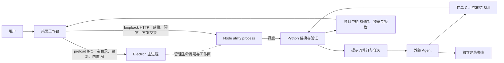

# NBTCreator 架构与文件结构

当前包版本见 [package.json](../../package.json)。桌面和外部 Agent 共用 Minecraft Java 1.20.1 建模引擎，通过项目文件衔接。

## 运行架构



| 层 | 职责和接口 |
| --- | --- |
| 桌面界面 | 预构建工作台、3D 查看器和创作方案。界面通过 preload IPC 调用选目录、内置 AI 和更新等能力，由 Electron 主进程处理。 |
| 任务执行 | 工作台直接向 Node utility process 托管的 loopback HTTP 服务请求建模、预览和方案交接。服务校验工作区输入并按需调度 Python。Electron 主进程负责启动、停止和切换工作区。 |
| 工具契约 | `tool-catalog.json` 定义 CLI 映射、工具字段和参数范围。桌面和外部 Agent 用同一契约调用活跃引擎或其带哈希的冻结版本。 |
| 外部协作 | 创作项目生成 `nbtcreator-workspace`。Agent 从项目根目录用 CLI 读取任务、选资料、生成和验证。维护资料可单独启用。 |
| 外部数据 | 建筑书库是用户显式选择的本地参考，下载和离线检索分开。构件配方由独立 AssetLibrary 发布，软件内有带校验的发行快照。 |
| 运行环境 | Windows 便携包内含 Electron、mise 和 Chromium。Python 和 Git 从环境解析，支持 `NBTCREATOR_PYTHON` 与 `NBTCREATOR_GIT`。 |

### 一次建筑任务

1. 用户在工作台编写方案。可选的内置 AI 生成设计建议，用户采纳后仍可编辑。模板将有效字段、项目规范、约束和工具计划编成正文，并保存结构化输入。
2. 用户确认交接后，提示词正文、方案、操作计划和坐标草案冻结为任务修订。Agent 可以先只读查看，再领取租约。桌面「待领取」仅展示可领取任务；释放或超时后可再次领取。领取状态与审批分开。
3. Agent 按冻结 Skill 读取适用章节，按需从书库查询原始资料。引擎产生几何并验证方块状态、声明洞口和玩家通路。露天空间、密闭要求、开洞策略和洞口净尺寸随项目约束传递；SAODG 接入由专用扩展启用。
4. 保存制作版 SNBT、坐标上下文、墙层归属和验证记录。从同一落盘源出图，Agent 和用户据图复核。精修须经人看图后同意，正式 NBT 通过独立定稿动作生成。

## 可维护性与外部 Agent 减负

### 桌面服务与版本发布

- **已落地。** 工作台的 preload IPC 与 loopback HTTP 在运行图中分开。桌面和 CLI 发布受管制作版时使用同一个引擎入口，共用按建筑划分的发布锁。锁内检查父版本及源状态，同一父版本并发发布最多有一个成功。过期父版本返回 `STALE_PARENT`，现行版本保留。任务租约负责交接任务的领取权，发布锁负责建筑版本的一致性。实现见 [工作模型](../../.agents/skills/minecraft-nbt-modeler/scripts/nbt_working_model.py)，并发场景见 [引擎回归测试](../../tests/engine/working-model.py)。
- **编辑会话路由已拆分。** `edit-session-routes.mjs` 处理最近会话、草稿读取和保存以及图片证据恢复，持久化继续由 `edit-session-store.mjs` 负责。公共服务统一处理工作区源绑定、Host/Origin 校验和 HTTP 错误，继续共用现有 Node utility process。启用草稿恢复时，桌面在发布请求前保存当前编辑会话。遇到 `STALE_PARENT` 后，重启可从原版本恢复候选设置、预览和镜头。并发回归覆盖桌面与 CLI 竞争、历史派生与 CLI 同时写入、同一父版本的建筑方案并发重建，以及基于胜出版本手动重试不冲突的编辑。参见[编辑会话路由](../../.agents/skills/minecraft-nbt-modeler/assets/viewer/edit-session-routes.mjs)、[桌面恢复回归](../../tests/desktop/edit-session-desktop.mjs)和[引擎回归](../../tests/engine/working-model.py)。

### 外部 Agent 脚本化路线

分区协作通过 `machine` 的 `authoring.*` 方法进入同一引擎。`nbt_project/authoring_runs.py` 在批次尝试中持有 `authoring.json`，`nbt_agent/authoring_tasks.py` 复用租约、fence 和幂等回执。`authoring_views.py` 根据已登记工作包投影提示词、动作和字段。`nbt_composition/authoring_merge.py` 复用 `WorkingModel.patch` 和整栋发布锁，`nbt_review/authoring_review.py` 用固定机位比较基线和候选或落盘版。Electron 在制作批次中读取相同协议和经过哈希核对的图片。[参考图与分区建模](../../.agents/skills/minecraft-nbt-modeler/references/authoring-workflow.md)

外部 Skill 默认载入创作相关资料，软件维护与接口扩展按工作区启用。纹样入口仍直接提示 `pattern_microfit` 的适用场景，度量实现已从位图适配层抽出，供拟合复用。建筑书库独立索引并按任务检索。紧凑任务视图、增量诊断和本地任务客户端已接入共享 CLI。统一的整栋初稿入口为后续设计。

| 顺序 | 脚本负责 | Agent 负责 |
| --- | --- | --- |
| 1. 紧凑任务视图 | `prompts.get` 的 `compact` 视图读取冻结表单摘录、阶段、约束、保护范围摘要、源匹配和上一条已发布修订差异。正文、结构化表单、操作计划和坐标可分别展开。 | 理解意图、识别冲突、选择须展开的资料。 |
| 2. 方案到初稿 | 保存方案，调用所选建模入口，再统一执行 SNBT 回读、验证、审阅包准备和出图。脚本传递修订、路径和哈希，完整回执落盘，成功时返回制作源与待看机位，失败时返回阶段及证据。 | 按任务选择建模入口，决定空间、构造、纹样和细节程度，根据具体失败修改方案。 |
| 3. 增量诊断 | `diagnostics` 从原始回执按错误码和目标归并，指定上次回执时区分新增与持续问题。提供报告哈希与证据位置。审阅回执提供待看机位与 `delivery_summary`。 | 结合几何和图片判断失败原因，实际看图后记录所见与疑点。 |
| 4. 本地任务客户端 | `task-client` 只领取明确指定的任务，代管请求编号、租约、`fence` 和修订号。可运行 `keepalive` 定期续租，`retry` 按原编号和参数重放待确认请求。租约失效、源变化或版本冲突时停止任务写入。 | 决定是否接手任务，以及遇到冲突后继续、放弃还是重新设计。 |

整栋初稿可用 `plan-build` 从结构化方案构建，也可用 `WorkingModel` 脚本直接表达需要细粒度控制的构造。两条路径的制作版都进入同一套回读、验证和审阅流程。独立构件走构件入口，执行适用的验证。密闭、是否开洞及洞口净尺寸按当前项目配置，SAODG 专用约束随选用的扩展生效。参见[建筑方案](../../.agents/skills/minecraft-nbt-modeler/references/architecture-workflow.md)与[工作模型](../../.agents/skills/minecraft-nbt-modeler/references/working-model.md)。

归卷阁提供编排回归用例。外部 Skill 按任务选读对应案例段落，例如楼梯出口、室内站位或操作面的验证。布局、尺度、风格及机位由 Agent 按当前项目决定。参见[归卷阁样例](../../.agents/skills/minecraft-nbt-modeler/assets/examples/reading-loft/README.md)。

脚本出图后将机位标为待看，实际看图后才登记观察。用户批准触发精修，用户明确要求定稿后才导出正式 NBT。机器接口和脚本接续这些阶段的记录。参见[机器协议](../../.agents/skills/minecraft-nbt-modeler/references/agent-protocol.md)。

统一初稿入口实现后用两类案例验收：

- **归卷阁。** 对 `open`、`blocked`、`wrong-side` 分别记录改造前后的 Agent 可见输出字符数和工具调用数，并检查首条失败回执能否定位问题。成功例应返回制作源和实景图，另两例应分别定位梯顶 `stair_landing` 不可达和柜台 `return_desk.intake` 的 `wrong_side`。
- **布局明显不同的日式建筑。** 用 `WorkingModel` 制作初稿并接入同一套回读、验证和审阅流程。对照当前项目的需求和实际预览，检查空间组织、屋顶和主题纹样是否保留方案意图，验证记录是否对应本项目声明的约束。

## 软件源码

```text
NBTCreator/
├─ desktop/
│  ├─ main.cjs、preload.cjs、worker.mjs  桌面生命周期、受限桥接、本地执行服务
│  ├─ api-service.cjs、internal-skill.cjs  内置 AI 请求及工作流契约
│  └─ skills/nbtcreator-internal/       内置 AI 的短上下文指导
├─ .agents/skills/minecraft-nbt-modeler/
│  ├─ SKILL.md、references/             共享工作流与可选专题
│  ├─ tool-catalog.json                工具契约源
│  ├─ scripts/                         公共命令、建模 API 和共享运行时
│  │  ├─ nbt_agent/                    构建工具、Agent 任务、租约与机器协议
│  │  ├─ nbt_assets/                   素材库、构件、配方和效果
│  │  ├─ nbt_building/                 建筑方案、参数化构造和梁架细节
│  │  ├─ nbt_composition/              整模修改、分片装配和接合接口
│  │  ├─ nbt_geometry/                 体素选区、阵列、变形和道路
│  │  ├─ nbt_knowledge/                建筑书库、网页取证与参考资料检索
│  │  ├─ nbt_mounting/                 表面贴装、曲面浮雕和重复布局
│  │  ├─ nbt_pattern/                  纹样采样、设计、质量评估和面板编译
│  │  ├─ nbt_project/                  项目布局、建模批次、提示词和版本历史
│  │  ├─ nbt_review/                   诊断预览、参考视角和候选审阅
│  │  ├─ nbt_runtime/                  工具目录、参数校验、缓存和渲染依赖
│  │  └─ fixtures/                     可移植的合成回归
│  ├─ prompt-console/                  创作方案、提示词编译、任务队列
│  ├─ assets/viewer/                   3D 工作台、静态服务、前端构建
  │  └─ src/                          页面入口与共享界面模块
  │     ├─ components/                构件编辑、操作手柄和变换
  │     ├─ knowledge/                 知识引用、预览和设置
  │     ├─ library/                   素材、配方、纹样和效果
  │     └─ projects/                  项目目录、批次和历史
│  ├─ assets/extension-library/        独立 AssetLibrary 的发行数据快照
│  └─ constraint-extensions/           可选接入约束
├─ scripts/、mise.toml                  CLI、开发任务、前端构建与发行打包
├─ config/                            发布运行时与外部书目清单
├─ tools/                             独立迁移与历史兼容工具
├─ tests/{engine,node,desktop,support}/ 引擎、Node、桌面与共享测试夹具
├─ docs/{development,guides,archive}/    开发、用户和历史文档
└─ references/                        只读迁移参考
```

公共命令由 `tool-catalog.json` 路由到 `scripts/` 顶层的入口。创作脚本使用工具说明中的 Python 导入，例如 `from nbt_model import Model`。内部实现按职责使用子包，新增内部模块时放入对应子包。灰度纹样由 `nbt_pattern/` 处理，整模方块混材使用 `nbt_patterns.py`。Agent 任务、资产工具、整模编辑和预览继续从原命令路径进入对应子包。顶层入口也导出同一个 Python 实现，例如 `nbt_working_model.WorkingModel` 和 `nbt_modeling_session.ModellingSession`。冻结运行时和版本指纹都包含子目录。

在软件仓库根目录运行 `mise run nbt -- regress --output <新目录>` 可执行合成回归。单独重跑某套时，把夹具文件名传给 `scripts/fixtures/run.py`。

## 创作项目与外部数据

```text
创作项目根目录/
├─ .agents/skills/nbtcreator-workspace/
│  ├─ SKILL.md                         本工作区入口
│  ├─ knowledge.md                     已启用的知识索引
│  └─ nbt.py                           定位冻结引擎的 CLI
├─ .nbtcreator/
│  ├─ runtimes/<哈希>/                 可迁移的引擎副本
│  ├─ skill-exposure.json              工作区知识选择
│  └─ history/                        独立 Git 历史与对象
└─ nbt_models/
   ├─ <形状或项目目录>/<建筑>/
   │  ├─ 提示词方案/                    草稿、修订与交接任务
   │  └─ <制作版本>/                    master/model.snbt、坐标、图片与验证
   ├─ _workspaces/                     任务索引、检查和批次过程数据
   └─ _exports/                        显式定稿产生的 NBT 交付

外部建筑书库目录/
├─ books.json、illustrated-originals.json   来源、版本与校验值
├─ architecture.sqlite                    可重建的离线索引
└─ 电子书原文与扫描件
```

分组项目可用房间身份把共享约束、提示词与制作版本归在同一个项目树里。上述创作路径记录的是归属关系，实际入口通过工作区索引定位。测试工作区、下载的外部书库和用户凭据均在发行包之外。

## 发布门禁

- 先核对变更范围、架构和目录设计，再准备目标版本提交及发布说明。
- 在要打标签的同一提交上核对 GitHub Actions `build` 汇总门禁。五组 Windows 检查分别覆盖源码契约、素材桌面、整模流水线、创作契约和实际打包。
- 审阅通过且 CI 通过后，核实远端标签及 Release 尚不存在，为已验证提交创建并推送 `v<版本>`。标签流水线复跑构建并校验发行包后创建 Release。

相关资料：[共享工作区](../guides/SHARED_WORKSPACE.md) · [API 与 Skill 集成](API_INTEGRATION.md) · [构建与发布](CI_CD.md)
