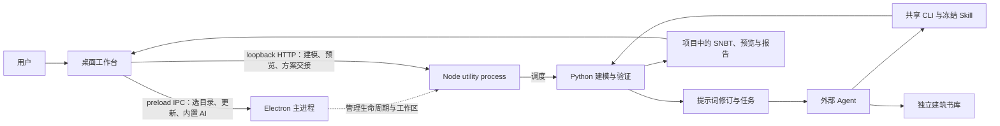

# NBTCreator 架构与文件结构

这份文档记录 4.0 发布审阅前的工作树实现。当前包版本见 [package.json](../../package.json)。运行阶段使用同一个 Minecraft Java 1.20.1 建模引擎，桌面和外部 Agent 通过项目文件衔接。

## 运行架构



| 层 | 职责和接口 |
| --- | --- |
| 桌面界面 | 预构建工作台、3D 查看器和创作方案。界面通过 preload IPC 调用选目录、内置 AI 和更新等能力，由 Electron 主进程处理。 |
| 任务执行 | 工作台直接向 Node utility process 托管的 loopback HTTP 服务请求建模、预览和方案交接。服务校验工作区输入并按需调度 Python。Electron 主进程负责启动、停止和切换工作区。 |
| 工具契约 | `tool-catalog.json` 定义 CLI 映射、工具字段和参数范围。桌面和外部 Agent 用同一契约调用活跃引擎或其带哈希的冻结版本。 |
| 外部协作 | 创作项目生成 `nbtcreator-workspace`。Agent 从项目根目录用 CLI 读取任务、选资料、生成和验证。维护资料可单独启用。 |
| 外部数据 | 建筑书库是用户显式选择的本地参考，下载和离线检索分开。构件配方由独立 AssetLibrary 发布，软件内有带校验的发行快照。 |
| 运行环境 | Windows 便携包内含 Electron、mise 和 Chromium。Python 和 Git 从环境解析，支持 `NBTCREATOR_PYTHON` 与 `NBTCREATOR_GIT`。 |

### 一次建筑任务

1. 用户在工作台编写方案。可选的内置 AI 生成设计建议，用户采纳后仍可编辑。模板将有效字段、项目规范、约束和工具计划编成正文，并保存结构化输入。
2. 用户确认交接后，提示词正文、方案、操作计划和坐标草案冻结为任务修订。Agent 可以先只读查看，再领取租约。桌面「待领取」仅展示可领取任务；释放或超时后可再次领取。领取状态与审批分开。
3. Agent 按冻结 Skill 读取适用章节，按需从书库查询原始资料。引擎产生几何并验证方块状态、声明洞口和玩家通路。露天空间、密闭要求、开洞策略和洞口净尺寸随项目约束传递；SAODG 接入由专用扩展启用。
4. 保存制作版 SNBT、坐标上下文、墙层归属和验证记录。从同一落盘源出图，Agent 和用户据图复核。精修须经人看图后同意，正式 NBT 通过独立定稿动作生成。

## 软件源码

```text
NBTCreator/
├─ desktop/
│  ├─ main.cjs、preload.cjs、worker.mjs  桌面生命周期、受限桥接、本地执行服务
│  ├─ api-service.cjs、internal-skill.cjs  内置 AI 请求及工作流契约
│  └─ skills/nbtcreator-internal/       内置 AI 的短上下文指导
├─ .agents/skills/minecraft-nbt-modeler/
│  ├─ SKILL.md、references/             共享工作流与可选专题
│  ├─ tool-catalog.json                工具契约源
│  ├─ scripts/                         建模、校验、渲染、归档、机器任务及检索
│  ├─ prompt-console/                  创作方案、提示词编译、任务队列
│  ├─ assets/viewer/                   3D 工作台、静态服务、前端构建
│  ├─ assets/extension-library/        独立 AssetLibrary 的发行数据快照
│  └─ constraint-extensions/           可选接入约束
├─ scripts/、mise.toml                  CLI、开发任务、前端构建与发行打包
├─ config/                            发布运行时与外部书目清单
├─ tools/                             独立迁移与历史兼容工具
├─ tests/{engine,node,desktop,support}/ 引擎、Node、桌面与共享测试夹具
├─ docs/{development,guides,archive}/    开发、用户和历史文档
└─ references/                        只读迁移参考
```

## 创作项目与外部数据

```text
创作项目根目录/
├─ .agents/skills/nbtcreator-workspace/
│  ├─ SKILL.md                         本工作区入口
│  ├─ knowledge.md                     已启用的知识索引
│  └─ nbt.py                           定位冻结引擎的 CLI
├─ .nbtcreator/
│  ├─ runtimes/<哈希>/                 可迁移的引擎副本
│  ├─ skill-exposure.json              工作区知识选择
│  └─ history/                        独立 Git 历史与对象
└─ nbt_models/
   ├─ <形状或项目目录>/<建筑>/
   │  ├─ 提示词方案/                    草稿、修订与交接任务
   │  └─ <制作版本>/                    master/model.snbt、坐标、图片与验证
   ├─ _workspaces/                     任务索引、检查和批次过程数据
   └─ _exports/                        显式定稿产生的 NBT 交付

外部建筑书库目录/
├─ books.json、illustrated-originals.json   来源、版本与校验值
├─ architecture.sqlite                    可重建的离线索引
└─ 电子书原文与扫描件
```

分组项目可用房间身份把共享约束、提示词与制作版本归在同一个项目树里。上述创作路径记录的是归属关系，实际入口通过工作区索引定位。测试工作区、下载的外部书库和用户凭据均在发行包之外。

## 4.0 发布门禁

- 先核对变更范围、架构和目录设计，再准备版本为 `4.0.0` 的目标提交及发布说明。
- 在要打标签的同一提交上核对 GitHub Actions `build` 汇总门禁。五组 Windows 检查分别覆盖源码契约、素材桌面、整模流水线、创作契约和实际打包。
- 审阅通过且 CI 通过后，核实远端标签及 Release 尚不存在，为已验证提交创建并推送 `v4.0.0`。标签流水线复跑构建并校验发行包后创建 Release。

相关资料：[共享工作区](../guides/SHARED_WORKSPACE.md) · [API 与 Skill 集成](API_INTEGRATION.md) · [构建与发布](CI_CD.md)
