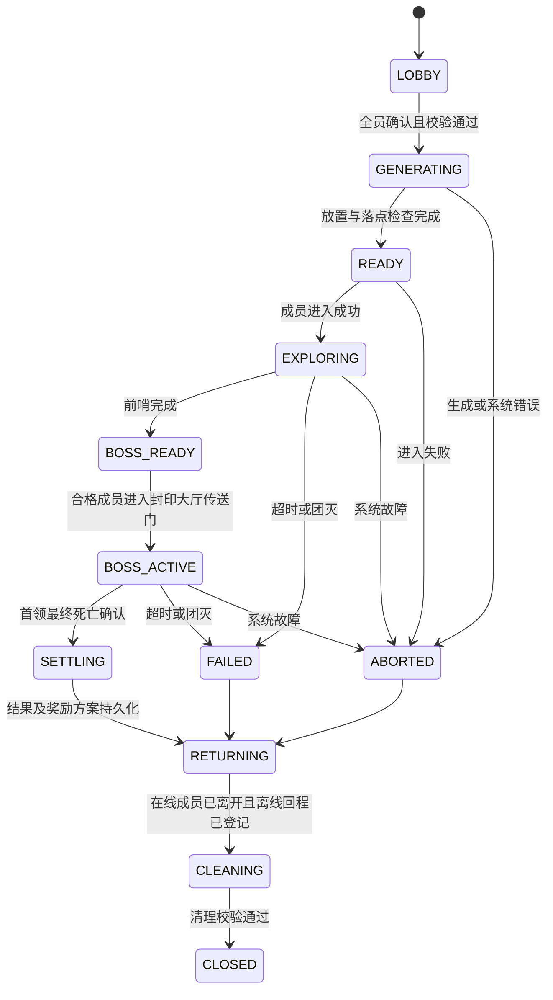

# SAODG 独立迷宫区模组完整方案

版本：设计稿 v0.1；日期：2026-10-27。

本文确定首轮实现基线，可据此拆分开发任务。本文中的 `saodg:*` 注册项、命令、接口、配置和数值描述目标设计；当前已实现范围以[开发说明](DEVELOPMENT.md)和[验证记录](validation/M0_BASELINE_2026-10-27.md)为准，其余仍为规划。数值是测试起点，不是实测平衡结论。已存在接口与新增接口的区别见[集成契约](INTEGRATION_SPEC.md)。

## 1. 目标与边界

开发一个独立 JAR 的 Forge 模组，提供可反复挑战的多人副本。玩法循环为：组队准备 → 随机迷宫 → 分路清房与探索 → 钥匙开门 → 前哨挑战 → Boss → 评分 → 个人宝箱 → 回城。

目标体验：路线每局变化，房间有可学习的机制，探索与通关速度存在取舍，队友可以分工，失败能够复盘，奖励与服务器现有成长体系相容。

| 决策 | 首发基线 |
| --- | --- |
| 技术 | Minecraft 1.20.1、Forge、Java 17；具体 Forge 小版本随真实整合包锁定 |
| 发布 | SAODG 独立客户端/服务端模组，两端安装相同协议兼容版本 |
| 依赖 | 基础功能只依赖 Minecraft/Forge；SAO、KubeJS、FTB 作为可选适配，服务器正式预设要求所需适配就绪 |
| SAO 目标 | 现有核心与配套补丁；不使用已归档的重写版 API |
| 人数 | 每局 1～4 人；服务端参数化，扩大人数需重新验收 |
| 实例 | 一个固定注册维度内分配隔离区域，不为每次开本动态注册维度 |
| 内容 | 结构 NBT＋数据包 JSON；入口、开放条件和经济联动交给 KubeJS |
| 兼容 | 复用 SAO 职业、剑技、体力与濒死；迷宫区核心不导入 SAO 内部类型 |
| 首发经济 | 免费入场，基础奖励＋个人宝箱；付费宝箱在事务验收后开启 |
| 存档 | 保留既有世界与玩家数据；SAODG 新建自己的命名空间与 schema |

不在首发范围：复制 Hypixel 的地图或资源、完整复刻其装备数值、全新七职业、跨服务器匹配、动态维度系统、任意第三方 Boss 自动兼容、全功能可视化编辑器。参考玩法，自行制作代码、房间、文本和素材。

## 2. 范围划分

| 阶段 | 交付内容 | 可对玩家开放程度 |
| --- | --- | --- |
| 技术原型 | 固定小地图、清怪开门、独立实例、回程、无经济奖励 | 仅管理员测试 |
| 垂直切片 | 完整一局、单 Boss、濒死/死亡区分、个人免费奖励、重启恢复 | 白名单测试 |
| v1 首发 | 第一座随机迷宫区、秘密与谜题、地图 HUD、评分、奖励档案、两队并发 | 通过验收后开放 |
| v1.1 | 更多房间、第二首领/楼层、付费宝箱、基础保底、制作工具改进 | 内容与经济分别验收 |
| 后续 | 更多迷宫区主题、挑战词缀、赛季、经验证的职业专属互动 | 不作为 v1 前置条件 |

v1 内容最低规模：1 个主题、12 个普通战斗模板、3 个精英模板、3 个谜题模板、2 个安全房模板、1 个前哨模板、1 个 Boss 场地；每局从中抽取子集。模板均由本项目制作，数量不足时不要宣称已具有重复游玩所需的变化量。

## 3. 玩家流程

### 3.1 入口与准备

1. 玩家通过现有 NPC、`/saodg` 或模组菜单进入副本页。
2. 选择迷宫区、难度，查看解锁条件、推荐装备、死亡规则、预计时长和奖励范围。
3. 读取 SAO 队伍，邀请本次参与者逐个确认。社交队伍可超过 4 人，但本次最多选 4 人；不踢除社交队伍中的其他人。
4. 创建本局大厅与独立房主，房主是大厅创建者，不从 SAO 队伍名推断队长。
5. 每人准备确认绑定 `lobbyId + revision`。人员、难度或配置版本变化使准备状态失效。
   房主可从本次大厅移出选定成员，离线成员也可移出；不能通过此操作移出房主本人，房主退出仍关闭大厅。该操作只调整本局名单，不改变原 SAO 社交关系。
6. 开始时再次校验在线、条件、濒死、其他实例占用及适配器状态，然后固定成员 UUID、职业快照、人数和难度。
7. 地图生成和校验完成后传送。任一成员无法进入则撤销整个开场流程，恢复已进入成员的位置；免费入场阶段不涉及门票退款。

默认大厅有效期 120 秒；生成超过 30 秒未完成则中止并记录原因。数值可配置，生成超时不处罚玩家。

本局名单与原生社交关系分别处理：换队不改变已冻结的本局资格，但首发救援/职业治疗仍遵守SAO当前同队条件。界面提示局内换队可能失去原队友救援；不为冻结名单擅自改玩家计分板队伍。跨实例治疗即使来自同一社交队伍也必须拒绝。

### 3.2 局内流程

入口安全区完成加载后开始计时。探索期间允许分路；普通房间只封闭自己的挑战门，不把所有玩家强制拉到房间中。主路封印门需要共享钥匙，支路提供秘密、补给和评分目标。

封印大厅波次完成后开启实体传送门；任意合格成员进入，即将本局在线未淘汰的存活成员一起传送到已验证的首领场地落点，无需逐个确认。0.40 起首领场地额外生成在探索网格外，无步行连廊，不占探索格子；只有封印大厅传送门能触发正常转场。离线成员保留原重连资格，已淘汰成员不重新入场。

Boss 战开始后关闭探索区域的领奖与机关交互，冻结探索计分目标；先显示“探索将结束”，避免玩家误触不可逆阶段转换。

### 3.3 返回与重连

- 正常退出、被淘汰、超时、团灭和管理员中止都有确定的回程路径。
- 原返回点若已失效、危险或维度不存在，回到配置的公共大厅，再回退世界安全出生点。
- 返回位置包括维度、坐标、朝向与原游戏模式。不要把副本临时状态写成永久出生点。
- 玩家断线后默认保留资格 120 秒，实例计时继续；全部成员离线后仅保持恢复窗口，暂停生成新怪，窗口结束后中止。
- 重连必须仍为原名单且本局未结束；探索中回到服务端最后确认并已发现房间的预设落点，缺少有效记录则回入口；首领战回到首领安全入口，不直接复用断线坐标。世界重启仍中止进行中的实例，不将内存检查点当作跨重启恢复凭证。
- 已淘汰成员重连不恢复存活身份。真正死亡后重生是淘汰者；离线与淘汰分别保存。

## 4. 迷宫区内容与首发样本

首发主题暂名“迷宫区·遗迹回廊”，ID 为 `saodg:ruins_01`，与 SAO 世界楼层编号分开。副本不是通关 SAO 主线楼层的捷径。

| 难度 | 主要用途 | 每局房间构成（不含多格占地） | 目标时间 / 硬时限 |
| --- | --- | --- | --- |
| 试炼 | 单人练习与机制教学，奖励降低 | 入口1、战斗4、精英1、谜题1、安全1、前哨1、Boss1 | 12 / 25 分钟 |
| 标准 | 首发核心循环 | 入口1、战斗7、精英2、谜题2、安全1、前哨1、Boss1 | 18 / 30 分钟 |
| 精锐 | 同主题高难版，首轮平衡后开放 | 入口1、战斗8、精英3、谜题2、安全1、前哨1、Boss1 | 22 / 35 分钟 |

解锁不硬编码进引擎。基础模式可使用迷宫区自身首通条件；服务器预设通过 KubeJS 校验 SAO 等级、现有 FTB 任务或居民任务。具体数值和任务 ID 在确定对应服务器进度后填写，不能杜撰现有任务 ID。

当前开发内容 `ruins-dev-21` 将试炼设为入口；标准需要本迷宫区一次合格试炼通关，精锐需要一次合格标准通关。
条件写在各难度的 `admission` 数据中，不隐式折算其他难度，不因创建者或队友已解锁而替所有成员通过。
此选择只定义开发成长流程，不代表正式服务器 SAO/FTB 开放条件已经确定；正式预设仍受原有集成与验收门槛限制。

首发标准局建议秘密总数 8～12，至少 2 个需要观察而非战斗的目标；每局保证一个可达安全房。随机性改变路线、模板、波次和秘密位置组合，不随机破坏关键机制的可解性。

当前开发内容为标准 11 处秘密。模板以海晶灯、青苔、铜砖或断墙指向磁石，并加入先读金纹黑石、再寻找藏物的铭文秘密；不要求职业、飞行或消耗装备。
标准的精英/谜题槽位保证至少 4 处铭文目标。读取只建立本队本局线索，确认找到后才记录首次解读/发现参与，不用未完成阅读或重复解读刷资格。
这些新素材、文本与两步交互只写入源码，尚未构建或运行，不据此宣称探索、可达性或平衡已经通过。

## 5. 房间、钥匙与谜题

### 5.1 房间类型

| 类型 | 完成条件 | 失败与防卡关 |
| --- | --- | --- |
| 普通战斗 | 一次生成固定星标与普通敌人，星标全部确认死亡即完成 | 普通敌人不计清房进度；必要敌人异常丢失不算完成 |
| 精英 | 多轮固定敌人，每轮清完星标后进入下一轮 | 普通敌人是否必杀由星标定义明确指定 |
| 前哨（封印大厅） | 多轮固定星标与普通敌人，最后一轮星标确认死亡后开启首领传送门 | 生成失败中止，不空刷领奖 |
| 谜题 | 服务端验证谜题解答 | 可重试但记录失败；关键路线不能被一次失败永久锁死 |
| 秘密 | 触发唯一秘密标识的有效交互 | 团队只记一次；重复点击不发物品和分数 |
| 安全 | 补给、回程、机制提示 | 无可无限刷取的物品或治疗贡献 |
| Boss | 完成首领全部阶段和最终死亡确认 | 阶段转换、分身消失不能判为通关 |

### 5.2 门与共享钥匙

2026-10-28 按人工测试反馈更新：起始模板固定为当前 `saodg:ruins/entrance_01`，相对实例网格位置 `(2,5)`、旋转 0；相同内容池不随种子随机起点，其余地图继续随机。
将前哨房在玩家界面称为封印大厅，内部 `OUTPOST` 标识保持以兼容数据引用。通往封印大厅的唯一主路保留清房/钥匙门，其他支路自由通行，未清理的支路不再阻止封印大厅激活。按 0.39.1 最新要求，普通房固定一批星标/普通敌人，精英房和封印大厅保留多轮；清完各轮星标后完成，不要求清掉剩余普通敌人，离开返回不重新生成已出现的批次。

0.41.62 在上述一次生成/波次规则内随机选择怪物种类与安全出生点，星标满 200 tick 发光。产钥匙房清场后先出现三维队伍钥匙，有效成员靠近或 100 tick 后收取，之后才获得对应开门/首领准备资格。奖励箱采用三档不同 SAO 模型及居中精简的个人奖励界面；[实现与验证](validation/ROOM_REWARDS_0.41.62_2026-10-30.md)。
主路入口第一段直接连通；之后每间主路战斗房完成后自动取得一把团队通行钥匙，靠近下一道实体门右键才消耗并打开，不自动随清房消失。0.40.1 起若下一间是安全房，入口直接开放，门移到安全房通往后续房间的出口，仍使用前一间战斗房的钥匙，安全房不额外产钥匙。
钥匙归属由该局已完成房间证明，已使用的门独立持久记录，重复清房或重复/副手点击不重复取得或消费；背包内伪造物品不能作为钥匙。
未连接出口用石砖封墙，主路锁门整面使用煤炭块，不使用屏障。战斗开始不会封闭支路，主路门状态同时约束普通移动、技能、投射物与地图投影。
封印大厅完成仍单独产生首领钥匙，并在封印大厅首领出口开启实体传送门；任一合格成员进入，即将本局在线未淘汰成员带入首领房，无需逐人确认。已淘汰成员不复活，离线成员沿用重连/回程。
开启首领战前可以继续探索支路。评分仍按实际完成的战斗、秘密和谜题计算，不因允许速通而自动补满分。
0.38 起主路也使用实际多格房间；地图合并同一逻辑房间的占地，只描外轮廓，不把 L/T/2×2 大房分割成多个独立 1×1 格。
0.41.12 起取消整条主路最多一个大房的固定上限；实际遗迹池的新局保证试炼至少 2、标准至少 3、精锐至少 4 个多格房间，主路和支路共同参与。主路保留适量空间给支路，大房候选在满足边界/端口/主路锚点后优先选取，保持模板去重优先；32 次内仍无法满足布局则明确失败，不降成只有一个大房的成功局。内容不足的自定义池按可用房间种类/位置能力降低目标，不强制单格内容变成大房。
0.41.13 按最新确认，谜题房只能位于支路尽头，图中度数为 1，不再借谜题房连接其他房间；安全房继续留在主线，入口开放、出口钥匙门规则保持。封印大厅仍是唯一主路末端，首领场地仍独立。
0.40 的独立首领房在每局 `(10,2)` 格额外放置，不属于 6×6 探索网格；四个出口石砖封闭，封印大厅传送门在封墙前生成。转场后地图切换到独立首领场地，保存、回程和清理仍归同一实例所有。

钥匙是实例账本中的计数/令牌，物品只作展示，不依赖玩家持有真实物品。一次开门在主线程原子校验：本实例成员、门状态、距离、钥匙余额、阶段，随后只消费一次令牌并持久记录。

生成器保证钥匙在对应门之前可获得；每个关键钥匙有唯一产出目标，重连、区块重载及房间重复完成不会重发。关闭门的实体碰撞、投射物、闪现和宠物穿越也要限制。

### 5.3 首发谜题

- **符文顺序**：房间内给出清楚的顺序线索，玩家依次激活机关。错序重置本题，失败最多计一次；答案由已保存种子固定。
- **光路重构**：旋转镜面或符文块，使光路连到终端。服务端在交互时计算有限图路径，不依赖每 tick 扫描整房。
- **协同封印**：多人版本激活分开的封印点；单人版本切换为顺序点亮并保留时间，不生成单人不可解机制。

每个谜题必须有提示、重置、退出和管理员诊断。秘密不要求特定付费道具、飞行或唯一职业。禁用造成真实装备损失的陷阱奖励设计。

当前开发模板将线索放在蓝色石块、重置放在红色陶瓦，读取/重置要求靠近并保持视线；当前房间页显示可见状态并提供再次确认的重置。
光路在世界内和面板显示当前镜面产生的路径，协同封印按服务器 100 tick 自动清理超时窗口；失误历史最多一条，重置不清除，不另改评分公式。
出口指引标记已探索、已开门的返程路线，玩家自行走回，不以谜题功能传送或跳过钥匙门。新模板与交互源码尚未运行验收。

## 6. 战斗、职业与首领

### 6.1 战斗数值

0.41.45 的守卫型普通房和精英末轮可通过遭遇schema 4显式配置一个星标小首领，分别已有回廊守卫长、遗迹冠军。它占现有必要目标名额，有独立预算和名称，按人数缩放一次；不触发最终Boss成功结算。封印大厅后的独立遗迹守门者仍承担最终Boss职责。[当前配置、证据与接入状态](validation/STARRED_MINIBOSS_0.41.45_2026-10-30.md)。

沿用 SAO 攻略等级、武器剑技、职业与体力，不新增法力。攻略等级首发只控制解锁和展示，不给巨额生命/伤害倍率。

怪物定义保存未缩放基值，人数缩放只在本局开始/怪物生成时应用一次。初始建议生命系数为 `1 + 0.55 × (人数 - 1)`；人数导致的攻击系数首发固定 1，难度另行配置。召唤物不计人数，中途断线不降低血量，重载不叠乘。

这些系数需要在实际 SAO 武器、技能、回血及第三方减伤下测量。按真实有效生命损失、倒地次数和战斗时长校准，不能仅拿面板攻击推导 DPS；持续监测但不在正在进行的战斗中自动改数值。

### 6.2 现有职业协作

现有源码包含觉醒战士、觉醒魔术师、忍者武士、召唤师、萨满、圣骑士、武术家。迷宫区通过站位、可打断目标、集火、躲避、救援与机制分工发挥职业差异。

首发不强制一坦一奶、不限制重复职业。进入时记录职业，是否允许局内切换沿用 SAO 原约束；局内切换导致的界面变化需要同步，但不重新计算怪物人数。

召唤物伤害归属到主人；治疗、护盾、减伤和控制无法可靠采样时显示“未统计”，不能用猜测数值影响奖励资格。重复给满血队友治疗不产出可刷取的贡献。

当前开发波次增加重卫的扇形横扫、游击者的定向刃气，以及可被有效伤害打断的咏唱者地面圆环。
预警开始后固定位置/朝向，实际伤害按服务器几何和房间/碰撞视线检查，保留侧移、绕背、找掩体与集火打断的选择。
已有来源绑定的职业、冰弓与蓝蔷薇冻结可停止新角色攻击，不要求特定职业；其他控制效果仍须有可靠原生语义后接入。
新角色属于开发内容，数值、动画、合法技能和多队性能尚未验收，不将其存在当作平衡已通过。

### 6.3 首发 Boss 草案：遗迹守门者

新增 `saodg:ruin_sentinel`，自行实现服务端 AI 与阶段控制，不继承会自动推进 SAO 攻略线的 `RaidBoss`。首轮可使用自制方块风格模型，不以完整新动画库作为前置依赖。

| 阶段 | 机制 | 公平性要求 |
| --- | --- | --- |
| 100%～70% | 扇形劈砍、地面冲击、可见预警 | 普攻间隔清楚；伤害区域按服务端时间判定 |
| 70%转场 | 两座封印装置与小怪，解除后继续输出 | 转场结束条件显式；单人也能操作；有最长阶段时间 |
| 70%～35% | 连续冲锋、目标锁定、分散站位 | 无穿墙追击和追到其他实例；位移有落点验证 |
| 35%～0% | 组合技能与短暂安全窗口 | 提速不等于不可躲避；避免连续强控无解链 |

阈值跨越只进入一次阶段。大量伤害越过阈值时按状态机处理，阶段无敌不能变成永久锁血。首领重启恢复按第 12 节的中止策略处理，不假装可以精确恢复任意 AI 动画时刻。

当前开发 `ruin-sentinel-2` 将冲锋改为固定方向的逐 tick 位移，并在二阶段使用两次分别锁定/预警的冲锋；不能瞬移穿过未验证的路径。
冲击圆环在起手时固定目标脚下，最终阶段的组合动作后保留可见休整窗口；不改原生伤害/护甲/濒死，也不以休整自动赋予额外伤害倍率。
新动作、24 点以内的定向粒子、原生冻结/阶段/实体替换中断、模型姿态及两队边界均只写入源码，尚未运行验收，数值仍是开发起点。

### 6.4 濒死、阵亡和团灭

先让 SAO 完成复活道具和濒死判定。濒死不记死亡，不发送领奖，不立刻淘汰；确认无法救起的真实死亡才增加一次本局死亡次数。

首发死亡掉落策略为 `inherit`：继承服务器现有规则，并在入场页明确展示。不得为保护副本玩家修改整个服务器的 `keepInventory`。独立无损死亡模式需要额外验证背包、护甲、副手、Curios、经验和其他模组的死亡复制，验收前不开放该选项。

`inherit` 还必须满足玩家资产可安全离开临时地图：若现有死亡规则会把玩家装备留在副本中，且尚无通过验收的保管/归还适配，正式预设拒绝开本。首发禁止主动向地面丢弃玩家物品；拒绝操作必须发生在物品从背包移除之前，不能通过事后取消掉落实体生成造成丢物。

确认死亡者在重生后送回大厅，保留本局结算资格但不能重新作为存活成员入场；首发观战通过迷宫区地图与队友状态界面完成，不赋予可飞往其他副本的原版旁观权限。

团灭条件：没有在线可战斗者，也没有仍处于救援窗口或重连窗口的合格成员。全员濒死时等待原生倒计时/救援结果；救援耗尽且无人可返回后失败。异常状态设定有限诊断超时，转为系统中止，不永久占槽。

## 7. 评分、奖励与长期成长

### 7.1 SAODG 自有评分

借鉴表现评分的方向，使用本项目自己的公式，不宣称等同 Hypixel。首发满分 300，只有成功击败 Boss 的局获得正式评级。

```text
战斗分 C = 70 × 必要战斗目标完成比例 + 30 × Boss完成标志
探索分 E = 50 × 秘密完成比例 + 30 × 谜题完成比例
时间分 T = 80 × clamp((硬时限 - 用时) / (硬时限 - 目标时间), 0, 1)
协作分 K = max(0, 40 - 4 × 确认死亡次数)
总分 S = floor(C + E + T + K)
```

用时不超过目标时间时 T=80。硬时限必须大于目标时间；总分限制在 0～300。当前内容没有秘密或谜题的评分预设必须显式说明该项满分或重分配，不能除零或偷偷改变某局权重。标准随机局要求存在秘密和谜题。

评级阈值为：S+≥290、S≥270、A≥230、B≥180、C≥120、其余 D。目标快但跳过探索通常拿不到 S+。协作分不按伤害、职业或治疗次数加分，避免排斥辅助及刷治疗。

| 标准局示例 | 得分 | 评级 |
| --- | --- | --- |
| 全目标、全秘密/谜题、18分钟内、无死亡 | 300 | S+ |
| 全战斗、秘密完成一半、全谜题、18分钟内、无死亡 | 275 | S |
| 全目标与探索、24分钟、无死亡 | 260 | A |
| 全目标与探索、18分钟内、确认死亡3次 | 288 | S |

全队评级相同，个人战绩仅供复盘。失败显示完成情况，不发成功宝箱；系统错误中止不记录挑战失败或排行成绩。首发无公开跨局竞速排行，防止未校准随机布局影响公平。

非成功复盘分别标记挑战失败、系统中止、主动结束，保存终止前的清房、谜题、秘密、探索完成数、用时、阵亡和个人参与。
只有同局固定成员能查看自己的投影；系统诊断原文不发送给玩家。保存确认后才进入历史，重复终止回调不修改已有结果。
重启时无法恢复的房间统计明确显示未知，不把缺失快照解释为零完成；旧版本已结束但未归档的失败局不追溯补写。
非成功记录不含评分、评级、奖励计划或合格通关凭证，不能影响成功奖励、难度解锁或公开成绩。

### 7.2 奖励结构

1. 基础奖励：攻略经验、绑定的基础材料，按合格成员各自生成。
2. 个人宝箱：生成普通、精良、珍藏等可选档位，高评级解锁更多档位，每人每局最多领取一档。
3. 免费档始终可选。付费档先预览确定内容与珂尔价格，确认后才提交；首次首发默认关闭付费档。
4. 物品方案由 `runId + playerId + rewardVersion` 对应的服务端专用奖励随机源生成并存档；不使用发给客户端的地图种子推导稀有掉落。
5. 重新开界面、重连、`/reload`、重启不重掷。背包满、余额不足或离线时保留待领取档案，不掉落地面。

领取与服务器钱包采用同一玩家文件中的事务回执，详情见[集成契约](INTEGRATION_SPEC.md)。不能只做一个“已领”布尔值后直接给物品，也不能先扣费再异步生成掉落。

### 7.3 参与资格与保底

资格由固定名单、有效在场和有效行为共同决定，不按伤害占比一刀切。测试起点：有效在场至少 `min(300秒, 本局时长×40%)`，且发生有效战斗、机制、秘密或成功救援中的至少一类行为；短局、开场即遭淘汰的情况需管理员可诊断。

有效行为必须来自服务端确认，重复同一秘密或机关不累计；活动窗口基于本局状态采样，不能仅靠发包或站在安全房。阈值在白名单测试后调整，拒绝奖励时说明具体未满足项。

v1 不承诺稀有保底。v1.1 可加入“完成并领取指定宝箱后增加计数”的个人保底，计数与领奖回执同次保存；所有触发、重置和跨档位规则公开配置。待领奖记录不静默过期或被容量上限覆盖。

### 7.4 经济边界

不发行第二套珂尔，不调用旧原生币余额代替服务器钱包。迷宫区不直接改变现有武器楼层限制、任务奖励 ID 或 SAO 主线首通标记。首发材料主要用于迷宫区横向内容和可控兑换，不直接让主线武器全面淘汰。

新开局默认不将临时迷宫区怪计入旧击杀目标；服务器可用 `allowLegacyKillObjectives` 选择沿用原版击杀统计、旧 FTB KillTask 与兼容任务历史，取值按局冻结。
此策略与原生 SAO 击杀 XP 分离，不关闭普通世界成长，不回滚旧进度；旧运行记录缺少策略字段时保留原行为。

上线前测量每人每小时珂尔净流入、基础材料供给和稀有掉落期望；未确认物品 ID、来源或效果的奖励不可发布。

### 7.5 迷宫区成长与装备扩展

v1新增素材为 `saodg:ruins_fragment`（遗迹碎片）和 `saodg:seal_core`（封印核心），当前已注册；源码增加绑定与显式开启的独立开发材料表。碎片作为稳定供给，封印核心作为精英/Boss相关结算材料；正式数量、概率、珂尔额度必须经过经济采样后写入版本化奖励表。默认原型仍只使用测试凭证，实验材料无正式兑换用途，不代表经济发布。

攻略经验的首轮测试公式可设为 `floor(100 × 难度系数 × (0.5 + 总分/300))`，难度系数分别为0.5、1、1.5；攻略等级L累计需求暂定 `100 × (L - 1)^2`，首发上限20。该成长只影响迷宫区解锁和展示；界面中的“攻略等级”属于 SAODG 独立进度，不改变 SAO 人物攻略等级；首通和重复通关均按固定领取操作推进，避免重复事件刷等级。

合格通关次数用于难度前置，与经验领取分开：Boss 确认结束后，把本局最终资格随战绩一同持久保存，按 runId 去重。
没有开启开发奖励也可记录新的合格通关，但不会补发经验或物品；未满足最终资格的成员不获得解锁凭证，确认死亡本身不额外撤销已满足的资格。
新增凭证使用显式 `progression_schema=1`；旧战绩不追溯重判或自动转为新解锁。攻略经验仍由原领奖事务保存，未确认资产状态不能用于新入场。

v1.1可增加迷宫区专属饰品/符文或外观兑换，优先提供横向选择。若增加星级强化，必须与原SAO强化NBT分开保存，只在受管实例内通过固定UUID的临时属性修改器生效，退出/死亡/重连后可重新计算和移除，不能直接改武器永久基础属性。具体战斗加成在首发数据稳定后单独设计，不预先承诺任意原生武器兼容。

## 8. 工程与模块架构

拟定 `modid=saodg`、包名前缀 `cn.saodg`。初期一个 Gradle 工程和一个发布 JAR，以包边界组织，暂不拆多项目。

```text
src/main/java/cn/saodg/
  bootstrap/             注册、服务装配、生命周期
  domain/                实例、房间图、评分、状态机与纯规则
  application/           开本、清房、结算、回程等用例
  api/                   稳定查询、请求与玩法事实
  infrastructure/        SavedData、日志、随机源、奖励日志
  platform/forge/        事件、实体、方块、菜单、网络
  integration/sao/       现有 SAO 适配及必要的定点兼容
  integration/kubejs/    插件绑定、脚本视图、脚本事件
  client/                地图、HUD、界面、渲染
src/main/resources/
  META-INF/mods.toml
  assets/saodg/          语言、纹理、模型、声音
  data/saodg/            地牢/房间/波次/首领/奖励配置与结构
src/test/java/cn/saodg/  JUnit 规则测试
src/gameTest/java/      拟配置的 Forge 运行时测试
```

客户端类不得在专用服务器公共类静态初始化中加载。纯规则不引用 Minecraft、SAO 或 KubeJS 类型，通过时钟、随机源与端口注入外部能力。

| 服务 | 单一职责 |
| --- | --- |
| `LobbyService` | 邀请、准备修订号、开始前检查 |
| `InstanceService` | 实例状态、玩家索引、并发上限 |
| `SlotAllocator` | 分配、隔离、清理和隔离故障槽位 |
| `LayoutGenerator` | 纯房间图、模板选择、可达性验证 |
| `StructurePlacer` | 限预算主线程放置与标记转换 |
| `RoomService` | 房间目标与唯一完成事实 |
| `EncounterService` | 波次、首领阶段、死亡确认 |
| `ScoreService` | 确定性评分快照 |
| `RewardService` | 固定奖励方案、资格、领取及恢复 |
| `ReturnService` | 安全返回、离线恢复、游戏模式恢复 |
| `CompatibilityService` | 外部能力探测与健康报告 |

所有游戏状态修改在服务器主线程执行。可把纯布局计算和配置校验移到工作线程，但只能使用不可变输入；不能在后台线程改方块、访问玩家背包或执行脚本。

## 9. 数据模型与状态机

### 9.1 核心对象

| 对象 | 必要字段 |
| --- | --- |
| `DungeonDefinition` | ID、schema、版本、人数、布局池、难度、时限、规则、评分/奖励引用 |
| `RoomDefinition` | 单模板或分片模板、外接尺寸、实际占地单元cells、连接口、刷怪/机关/秘密标记、完成条件、允许旋转 |
| `DungeonRun` | UUID、定义快照/散列、种子、槽位、阶段、修订号、计时、成员、图、目标、结果 |
| `RunMember` | UUID、显示名快照、职业快照、返回点、进入/在线/淘汰状态、资格证据 |
| `RoomRuntime` | 房间 ID、位置、旋转、状态、必要敌人 UUID、已完成目标、已取秘密 |
| `EncounterRuntime` | 遭遇 UUID、波次/阶段、父子实体关系、已确认死亡与上限 |
| `RewardOffer` | 局/玩家/档位、确定物品、价格、版本、有效状态、内容散列 |
| `RewardOperation` | 操作 UUID、选择、前置状态、提交/确认状态、重试及错误信息 |

玩家名只用于显示，权限、归属与回执均使用 UUID。保存数据不包含 `ServerPlayer`、世界、JavaScript 函数或实体对象引用。

### 9.2 实例状态



`BOSS_READY` 仍计时。每个转换验证当前状态与修订号，重复回调返回已处理。`SETTLING` 之后不能重新进入战斗；正常战斗结束与管理员强制清怪不是同一事件。

图中省略的统一出口也必须实现：所有已开始计时的战斗阶段（包括 `BOSS_READY`）都能因硬时限/团灭进入 `FAILED`，所有未封存结果的运行阶段都能因系统错误进入 `ABORTED`；两类终态均最终走回程和清理。

房间状态：`HIDDEN → DISCOVERED → ACTIVE → COMPLETED`；谜题可有可重试的失败子状态。实体异常缺失进入 `REPAIR_REQUIRED`，不能以“查不到实体”替代死亡证据。

每个确认死亡按 `runId + encounterId + entityUUID` 去重；跨模组取消事件后还活着的实体不产生死亡事实。确认流程至少检查最终未取消结果和下一 tick 存活状态，不能只依赖事件优先级排序。

## 10. 实例空间、地图生成与清理

### 10.1 槽位与隔离

固定维度 `saodg:dungeon` 使用空白生成器，初始槽位间距 1024 格，地图占地限制在 512×512 格内，四周留防护缓冲。49 格间距下新首领区预留单元为 (9,2)，历史 (10,2) 只按其持久清单恢复清理。默认并发上限 2 局、保留 4 个槽位；这些是资源上限，不是性能保证。

槽位状态为 `FREE / RESERVED / ACTIVE / CLEANING / QUARANTINED`。清理失败或残留不明的槽位隔离，绝不能仅清空运行 Map 就复用。持久化状态防止重启后重新分配到尚有玩家/实体的区域。

坐标分离只是空间布局，不是权限边界。所有玩家和受管实体必须带服务端实例归属；跨实例伤害、交互、拾取、宠物目标、位移和传送分别校验。

0.41.14 新生成保留 48 格模板单元，以 49 格运行时间距放置，房间之间新增一格短连接，钥匙门仅位于连接中央。多格房内部同样补齐无门通道；未连接出口保持石砖封墙。清理清单保存实际间距，旧清单默认 48，不随新版本错位移动。

### 10.2 生成算法

1. 固定定义版本、内容散列和种子，从已校验模板池获取不可变输入。
2. 在 6×6 网格内构建主路，放置入口、关键门、前哨和 Boss；多格房间占用全部 footprint。
3. 扩展支路，满足战斗、谜题、安全房和秘密的数量约束，限制模板重复。
4. 匹配连接口方向、开口宽高与地面标高。旋转同时作用于建筑、刷怪点、门、秘密和解谜标记。
5. 用带钥匙状态的图遍历验证主路，检查单人/多人可解、房间无重叠、秘密上限一致和 Boss 可达。
6. 最多尝试 32 次；失败后中止并输出种子、定义版本和验证原因。技术原型可显式选择固定测试图，正式随机局不能静默切换成不同奖励地图。
7. 在主线程按区块/方块预算分批放置，加载必要区块，生成完检查落点与房间标记。
8. 完成校验再允许玩家进入，之后才启动遭遇。

默认单元格 48×48 格。占地模型从首轮实现就支持任意连通的网格单元集合；首发内容先制作1×1、1×2和2×2，再接入L形、T形、十字与更长条形。`footprint`表示外接网格尺寸，`cells`才是实际占用；省略cells时可按完整矩形展开。模板局部坐标、朝向、实际占地和端口范围由统一变换函数处理，不在各机关里独立实现旋转。

例如L形的 `footprint=[2,2]`、`cells=[[0,0],[1,0],[0,1]]`，只占三格。缺角允许生成其他房间，但L形房的建筑和模板空气都不能写进缺角；分片按实际单元格导出和放置，并验证每片边界。各分片共享一个roomId、清怪目标、秘密集合和地图完成状态。

多格房间用 `parts` 定义各片 `template + offset`；单格可保留 `template` 简写，两种形式互斥。原版结构方块的每轴导出上限为48，因此96格以上的多格房间需拆片，不能要求制作人员一次保存整个外接矩形。[Minecraft结构方块尺寸变更](https://www.minecraft.net/en-us/article/minecraft-snapshot-20w16a)

正式门口标准统一为6格宽、5格高：以48格单元为基准，横向索引21～26、脚部局部Y=2、顶部Y=6。偶数宽开口绕单元中心旋转后仍对齐。端口使用闭区间 `min/max` 定义开口体积与 `facing`，旋转其完整范围，不旋转一个有歧义的中心整数点；L形凹边也只能在已占用单元与空单元的边界声明外部端口。

### 10.3 地图保护

首发拒绝非白名单破坏/放置、桶、刷怪蛋、外部传送、末影珍珠越门、流体越界和爆炸破坏；门、谜题方块和副本机关通过受控编辑上下文改图。流体、活塞、火、掉落、跨区块行为需要专门验收。

Forge 交互/爆炸事件不能覆盖所有模组直接改方块或直接设生命的路径，因此首发 Boss/机关只使用受管实现。第三方 Boss 必须逐个加入兼容白名单，不能宣称放进 NBT 就自动安全。

### 10.4 清理与区块票据

退出时先登记回程，再移出在线成员；移除本局受管怪物、投射物、机关实体和允许的掉落，按放置清单恢复槽位为空白。离线玩家在登录阶段被回程守卫截获，不要求其实体在线才可回收旧地图。

“允许的掉落”仅指可证明由副本生成的临时物品。玩家资产、未知来源ItemEntity、既有宠物或外部容器不允许直接清除；发现后隔离槽位并走明确归还/诊断流程。死亡策略的资产前置校验与禁止主动丢物用于减少此类情况，不能代替清理时的归属检查。

票据只覆盖生成片段、活动房与有玩家/必要 Boss 的区域；首发小地图可在明确上限内保持全部运行区域，但不得常驻所有空闲槽。退出、超时、生成异常、停服都有释放路径。清理按预算执行且可从日志恢复，不在运行时直接删除正在加载的 region 文件。

## 11. 配置、数据包与热重载

### 11.1 资源组织

```text
data/saodg/
  dungeons/ruins_01.json
  rooms/ruins/combat_01.json
  encounters/ruins/basic_wave.json
  dungeon_bosses/ruin_sentinel.json
  score_profiles/default.json
  reward_profiles/ruins_01.json
  loot_tables/dungeon/ruins_common.json
  structures/ruins/combat_01.nbt
  dimension/dungeon.json
  dimension_type/dungeon.json
```

`dungeons` 等自定义目录由 SAODG 资源重载监听器处理；它们不是 Minecraft 自动识别的原生注册目录。维度和结构使用 1.20.1 对应格式。配置中的资源路径和注册 ID 使用 namespaced ID，不保存运行时数值注册序号。

### 11.2 示例定义

以下是拟定格式示例，表示最小测试布局所需字段，不是已经可加载的发布资源；首发完整模板数见第 2 节。

```json
{
  "schema_version": 1,
  "content_version": "ruins-0.1",
  "display_name": "dungeon.saodg.ruins_01",
  "party": {"min": 1, "max": 4},
  "layout": {
    "grid": [6, 6],
    "cell_size": 48,
    "attempt_limit": 32,
    "room_pool": ["saodg:ruins/combat_01"],
    "required": {"entrance": 1, "combat": 1, "boss": 1}
  },
  "time": {"target_ticks": 21600, "limit_ticks": 36000},
  "rules": {
    "death_policy": "inherit",
    "reconnect_ticks": 2400,
    "allow_external_teleport": false
  },
  "score_profile": "saodg:default",
  "reward_profile": "saodg:ruins_01"
}
```

```json
{
  "schema_version": 1,
  "type": "combat",
  "template": "saodg:ruins/combat_01",
  "footprint": [1, 1],
  "size": [48, 24, 48],
  "rotations": [0, 90, 180, 270],
  "ports": [
    {"id": "east", "min": [47, 2, 21], "max": [47, 6, 26], "facing": "east"},
    {"id": "west", "min": [0, 2, 21], "max": [0, 6, 26], "facing": "west"}
  ],
  "encounter": "saodg:ruins/basic_wave",
  "secrets": [{"id": "cache_01", "position": [12, 2, 18], "type": "interact"}]
}
```

```json
{
  "schema_version": 1,
  "waves": [
    {
      "required": true,
      "prepare_ticks": 60,
      "timeout_ticks": 2400,
      "entities": [
        {"type": "minecraft:zombie", "count": 4, "spawn_group": "main", "required": true}
      ],
      "modifiers": {"max_health": 40.0, "attack_damage": 5.0}
    }
  ],
  "on_complete": {"room_complete": true, "shared_keys": 0}
}
```

结构内的 `main` 刷怪标记、入口/Boss 模板、评分与奖励引用仍需配套提供；示例不能绕过完整依赖校验。

### 11.3 重载规则

所有定义先加载到候选集合，验证 schema、资源存在、引用闭合、数值范围、模板标记和版本，再整体替换。失败保留上一份有效目录并输出资源路径与字段错误。

存活实例使用开局的不可变定义与奖励版本快照；`/reload` 只影响新局，不能让运行中的谜题换答案、Boss 换阶段或奖励重掷。快照包含恢复与结算所需的规范化数据，仅保存散列不足以恢复被删除的旧内容。

维度、方块、实体、网络与 startup 脚本的注册变更需要重启；普通 server 脚本和内容更新是否可重载按各适配层实际能力说明。

## 12. 存档、崩溃恢复与事务

### 12.1 保存职责

| 数据 | 权威保存位置 |
| --- | --- |
| 实例索引、槽位占用、运行/结束结果 | 主世界 `SavedData`，带 `schema_version` |
| 地图清单、阶段快照、奖励方案 | SAODG 世界数据及关键转换日志 |
| 玩家迷宫区成长、领奖回执、返回恢复标记 | `PlayerPersisted` 下 `saodg` 子树 |
| 珂尔余额、背包 | 既有钱包和玩家文件，SAODG 不维护第二份余额 |
| 待发送的 FTB/脚本事实 | SAODG outbox，按事实 ID 重试 |

`SavedData#setDirty()` 只表示需要保存，不是事务已落盘的证明。关键状态使用显式保存屏障和可恢复日志；细节见集成契约。不要在每次命中都同步保存整个世界。

### 12.2 保存时点

分配槽位前记录预约；放置前记录本轮放置边界；传送前保存玩家回程；进入 Boss/最终结算/生成奖励前后保存转换；领奖保存玩家资产与回执；回收前后保存槽位状态。一般进度每 10 秒合并检查点，关键转换立即保存，计时采用服务器 tick。

### 12.3 首发重启策略

- 正常关闭或异常重启后，尚未完成的战斗局统一转为系统中止，不恢复半场 Boss AI、谜题动画和瞬时技能。
- 在线成员停服前尽力回程；离线成员在下次登录时按已存标记回程。
- 已持久确认通关并生成奖励方案的局保留结果与待领资格；正在结算的局从完成日志继续，而非重打 Boss。
- 领奖中的跨文件确认按玩家回执恢复，绝不靠“服务器没回包”判断未发放。
- 中止不消耗未来门票、不计挑战失败；首发免费入场避免分布式退款问题。
- 恢复扫描与清理完成前，不开放受影响槽位。损坏或未知 schema 保留原数据，隔离对应内容并报告管理员，不静默重建覆盖。

停服/崩溃时不承诺回滚玩家已经消耗的药水、技能资源或已按原生规则发放的击杀经验。完整掉电后的耐久性仍受底层存储影响，不宣称跨多个 Minecraft 存档文件天然原子。

## 13. 网络、界面与可见性

客户端只提交意图：开大厅、准备、开门、操作谜题、选择宝箱、回程。服务端重新验证发送者、实例、距离、阶段、修订号和频率；客户端不能提交最终伤害、钥匙数量、奖励物品或珂尔价格。

网络包包含协议版本、实例 ID、请求序号和必要修订号；限制字符串、列表和 NBT 大小。快照首次完整同步，之后发送差量；过期修订号请求全量，不能重复应用增量。断线/换局清空客户端缓存。

小地图显示已发现房间、完成标记、门、在线队友与已公开目标。按最新地图要求，未探索轮廓仅向已发现房间的实际连接外延伸一层，统一显示灰色 1×1 问号格，不显示真实大小、房间类型、模板或完成状态；占位格选在连接已探索房间的门口，进入后才展开完整多格形状。不递归扩展，不提前揭示独立首领区。当前可见的封印大厅主线房间外框/连线标橙色，不额外公开更远主线；只有两端已发现的门才标明锁状态，锁门用红点提示。玩家标记使用房内细分位置和朝向，自己为金色、队友为青色。不下发未发现秘密位置、完整谜题答案或奖励随机种子；管理员预览权限独立。

确认阵亡并已回城的原成员可在本局仍活动或结算时只读查看地图和队友；此投影不恢复玩法成员索引、传送或机关权限，也不在外界绘制局内 HUD。主动离队不授予此资格；新大厅/新活动局优先，本局返回/清理后撤销。重启依旧中止旧局，不提供跨重启观战。

HUD 展示计时、当前目标、共享钥匙、房间进度、队友濒死/离线状态。默认靠边停靠，提供缩放和位置配置，避免覆盖 SAO 血量/职业/体力界面；不接管现有 O 键菜单和职业快捷键。游戏操作不因打开只读地图而暂停服务器。

0.41.28 提供面板右上角“显示设置”和 Forge Mods 配置入口，修改仅保存到本机。关闭小地图保留队友状态；首选缩放大于当前窗口时临时适配窗口，不改变保存值。打包已通过，实际客户端操作及与 SAO 界面的摆放仍待验证。

0.41.43 完整地图页同时按面板宽高确定格子大小，队友列空间不足时可滚动查看，并显示当前范围；地图、队友与底部说明分别限制在自己的区域。实际小窗口/GUI缩放画面与操作仍待客户端确认，不能以编译通过替代。

结算页显示分项得分、资格说明、基础奖励、可选宝箱、价格、待领状态与失败原因。余额不足、背包满、保存未确认需要明确文案，不显示虚假“领取成功”。

## 14. 地图制作与管理员工具

先提供命令和结构标记流程，再迭代 GUI。所有写入/强制中止/奖励修复命令默认要求 OP 等级 2，并记录操作者、局 ID 和原因。

| 拟定命令 | 用途 |
| --- | --- |
| `/saodg` | 玩家入口/本局页 |
| `/saodg leave` | 确认后退出并回程 |
| `/saodg rewards` | 查看自己的已结束局与待领奖 |
| `/saodg admin validate` | 检查当前内容目录与引用 |
| `/saodg admin status` | 适配健康、并发、票据、清理状态 |
| `/saodg admin inspect <runId>` | 读取阶段、目标、实体与奖励状态 |
| `/saodg admin abort <runId> <reason>` | 系统中止、回程、清理 |
| `/saodg admin preview <roomId> <rotation>` | 在制作区域预览模板与标记 |
| `/saodg admin recover <operationId>` | 根据持久事实重试确认，不直接额外发奖 |

制作流程：在专门制作存档建房 → 用结构方块导出 NBT → 定义连接口/刷怪/机关/秘密 → 校验四种旋转 → 单房测试 → 加入模板池 → 固定种子回归。模板发布前移除不应复制的实体、玩家头数据、命令方块及私人信息。

具体尺寸、坐标、导出设置、多格/L形分片与交付清单见[房间制作指南](ROOM_BUILDING_GUIDE.md)。

内容验证报告列出死路、无效落点、未注册实体、缺失奖励 ID、越界标记和未能旋转的结构。有限状态编辑器可后置，但从首个房间就采用统一元数据格式。

## 15. 性能预算与运行观测

首发设计上限：2 个运行实例、每局 4 名玩家、全局受管敌人 160、单局存活必要敌人 64。生成放置每 tick 初始预算 2048 个方块变更，全服同一时间仅进行一份大型地图生成。预算最终按实际服务器调整。

每 tick 的受管实例调度、生成和清理分别计时；使用实体 UUID 索引和玩家→实例索引，不全维度扫描所有实体。房间发现/边界采样可以每 5 tick 执行，UI差量以 5～10 tick 为起点；死亡、开门和结算按事件驱动。

仅涉及纯数据的工作可异步；结构放置、碰撞验证和实体操作留在主线程。生成队列超过资源上限时显示排队/容量已满，不无限保持区块票据。

记录：运行局数、生成耗时、每 tick 调度耗时、活动实体、区块票据、目标死亡确认、失败原因、奖励待确认数量、回程恢复数量和被隔离槽位。持久日志按局 ID/操作 ID 可追溯，普通命中不刷屏。

性能验收在服务器同硬件、同模组、同玩家人数的无副本基线下比较。稳定运行目标为 TPS接近20且总体P95 MSPT低于50ms；建议 SAODG 自身调度P95低于3ms，生成/清理P95低于5ms。这些是验收目标，不能当作当前测量结果；基线已超标时先记录背景负载。

## 16. 安装、更新与维护

SAODG 只发布自己的 reobfuscated JAR；不打包 SAO、上游参考模组或服务器静态配置仓库。正式服预设附带独立 KubeJS 兼容脚本与变更清单，在测试服验证后分别同步。

启动报告列出 Minecraft/Forge、SAODG版本/协议、SAO JAR与补丁哈希、KubeJS版本、所选适配器和能力缺口。基础独立模式可以在没有 SAO 时运行；正式服务器预设需要的适配器缺失时拒绝开本，不悄悄把全员判成等级1或未濒死。

升级前停止新开本、结束/中止活动局、确认待领奖和回程记录、备份世界与玩家文件，再更新。schema 迁移采用复制后验证，保留原文件；降级仅使用成套备份，不承诺新 schema 可被旧版读取。

文档与内容版本一起发布。地图删除不删除旧奖励方案；待领内容引用已展开为确定物品与价格，不需要旧掉落表仍然存在。

## 17. 开发任务与阶段出口

| 里程碑 | 任务 | 必须达到的出口 |
| --- | --- | --- |
| M0 工程基线 | Forge 1.20.1/Java17、源码布局、协议、JUnit/GameTest任务、独立配置 | 无SAO专服能启动；接入目标整合包也能启动；客户端类无专服泄漏 |
| M1 实例与回程 | 大厅、固定名单、槽位、固定地图、区块票据、退出/重启回程 | 两队互不影响；反复开关50局无残留占槽/票据 |
| M2 战斗闭环 | 普通房、波次、门、单Boss、濒死/确认死亡、失败 | 直接/投射物/宠物击杀一致；阶段不可重复结算；无未知旧奖励叠加 |
| M3 奖励事务 | 免费基础奖励、个人档案、回执、保存屏障、故障恢复 | 重复包、满包、保存失败、重启和断线不重复扣发 |
| M4 随机与内容 | 图生成、旋转、多格、谜题、秘密、内容校验 | 10000种子规则测试；内容最小规模；实际随机局可解 |
| M5 客户端与平衡 | 小地图、HUD、评分、结算、资格说明、数值采样 | 1～4人和两队并发实战通过，性能有真实报告 |
| M6 发布 | 兼容清单、升级恢复、运营命令、文档、安装包校验 | 全部P0/P1验收通过，形成可回滚测试服发布记录 |

付费宝箱、保底与无损死亡模式分别作为后续独立验收项；不因界面已经能显示就视为经济和存档路径完成。工期按每个阶段实际完成情况估计，当前不承诺日历日期。

完整检查项见[验收计划](ACCEPTANCE_PLAN.md)。任何里程碑完成必须报告真实检查结果，代码编译或Node脚本通过不等同Forge联机通过。

## 18. 风险、默认决策与待验证事项

| 项目 | 已作默认决策 | 实现前/上线前必须验证 |
| --- | --- | --- |
| 当前SAO版本 | 针对现有核心r234接口，补丁一并锁定 | 真实运行整合包的JAR与补丁哈希；本地源码不等同实际加载类 |
| 奖励叠加 | 迷宫区奖励统一经RewardService；已有SAO击杀经验保留一条路径 | ExternalKillXp、KubeJS额外XP、原生Boss与宠物归属 |
| 死亡掉落 | 首发inherit，入口展示并校验资产不会遗留临时地图 | 当前世界gamerule、掉落保管/归还能力与其他模组死亡策略，濒死/复活/Clone顺序 |
| 图与动作隔离 | 固定维度槽位＋服务端实例权限 | SAO位移、AOE、治疗、坐骑、宠物、回家与传送指令 |
| 阶段恢复 | 活动战斗重启后系统中止 | 玩家回程、领奖中途崩溃、槽位隔离与清理 |
| 世界主线 | 不写SAO主线标记；FTB迷宫区目标使用独立事实 | 原版击杀统计和FTB KillTask可能造成旁路推进 |
| 地图与数值 | 自制遗迹主题、1～4人 | 房间制作、玩法可读性、低配客户端与真实多人时长 |
| 内容授权 | DungeonZ/Gateways按实际MIT复用留来源；DimDungeons只读设计 | 实际引入的代码、素材分别核验，见参考索引 |

可先开发引擎、测试和制作流程，不必等待未知奖励物品或任务ID。正式内容发布前必须把开放条件、奖励ID、死亡策略和兼容基线全部填成可校验配置，不把未知项当作已通过。

## 19. 参考依据

- [本地参考源码、固定提交与许可记录](REFERENCE_GUIDE.md)：DungeonZ关注内容与进出，DimDungeons关注布局/放置分离，Gateways关注波次和玩法事件。
- [SkyBlock社区Wiki：Dungeons](https://hypixelskyblock.minecraft.wiki/w/Dungeons)：参考随机房间、多人协作、Boss与奖励循环，不作为本模组API规范。
- [SkyBlock社区Wiki：Dungeon Score](https://hypixelskyblock.minecraft.wiki/w/Dungeon_Score)：参考分项表现评分；本文使用自己的公式和阈值。
- [SkyBlock社区Wiki：Dungeon Reward Chest](https://hypixelskyblock.minecraft.wiki/w/Dungeon_Reward_Chest)：参考表现解锁个人宝箱和选择领取的交互，不复制经济数值。
- [Forge 1.20.1 Saved Data](https://docs.minecraftforge.net/en/1.20.1/datastorage/saveddata/)：世界数据与保存标记的技术依据。

主线设计决策以本文和配套集成/验收文档为准；第三方页面的描述不是本项目已经完成或兼容实测的证明。
