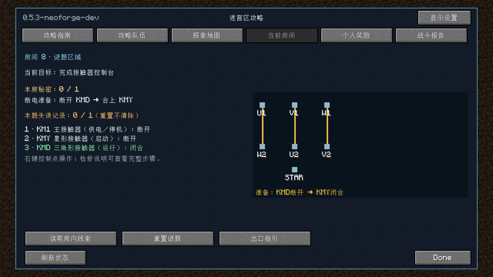
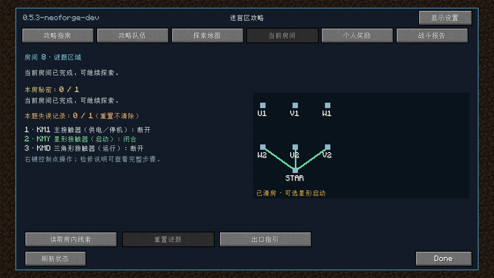
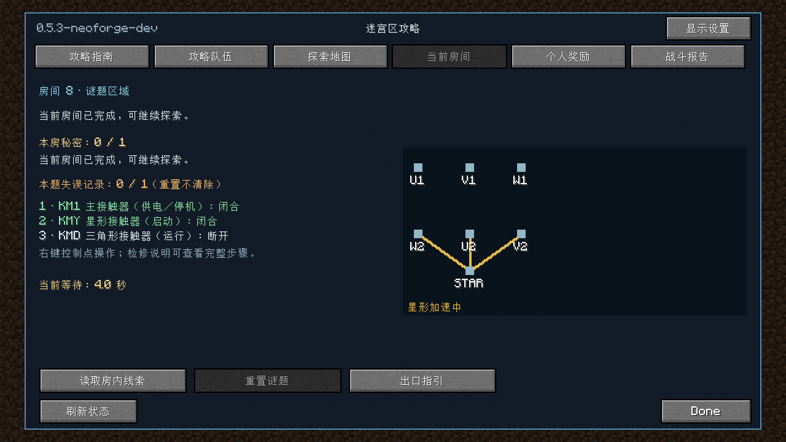
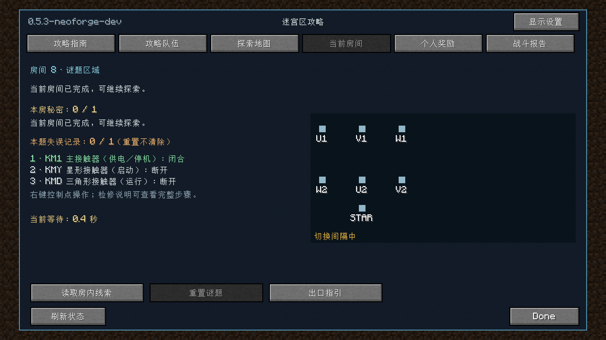
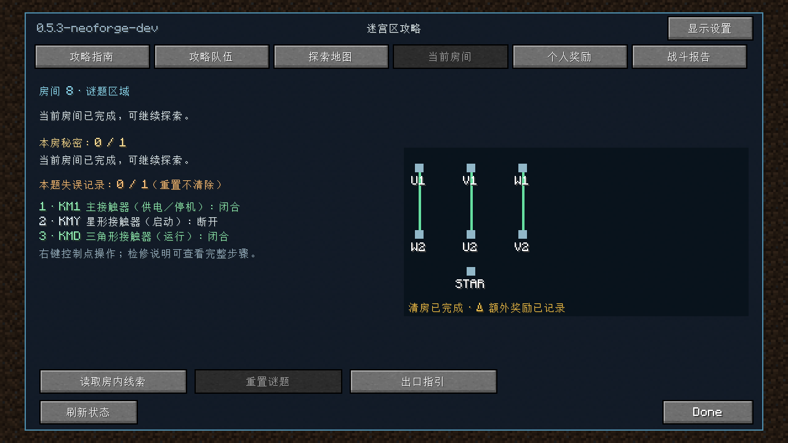

# 接触器控制台验证

2026-11-01，Minecraft 1.20.1 / NeoForge 47.1.106 / Java17 / Gradle8.8 / ForgeGradle6.0.54。版本0.5.3-neoforge-dev，协议26。玩法和完整中文步骤见[玩家说明](../CONTACTOR_ROOM.md)。

## 行为与兼容性

三处控制由绕组末端四档跨接改为 KM1/KMY/KMD 接触器，接触器整组三相切换。断电准备星形立即清房；启动后100 tick加速、星形断开后10 tick间隔，再允许三角形合闸。互锁拒绝错误请求，不再产生旧谜题的爆炸/雷击。停机可以重启，重新加速；保留清房、原解谜参与和每房一次的追加奖励事务。

主/星形/三角形状态、白色断开/绿色闭合、步骤、互锁提示、倒计时、阶段就绪通知和本局冻结的追加奖励数量均通过本地化展示。服务端仍检查成员、实例、距离/视线、阶段和意图修订号。网络两端需更新；房间ID、生产建筑、存档字段及奖励参数保持原格式，不提供进行中实例的跨版本热迁移。

## 实测

- 最终根工程定向构建成功：48项JUnit（谜题25、客户端23）全部通过，无跳过；包括GameTest和packTest夹具编译、重混淆打包。使用测试过滤器，**不代表默认完整套件通过**。完整布局回归未跑完，未将中止的结果计为通过。日志 `logs/contactor-build-scoped-20261101.log`。

- 隔离副本 `.gradle/contactor-runtime-20261101` 的定向谜题 JUnit：25/25通过，包含7项接触器测试，覆盖互锁、100/10 tick边界、随机操作安全、停机重启、一次性就绪通知及成功后锁定。
- 同副本 NeoForge `saodg_circuit` GameTest：4/4必需测试通过，正常停服。验证非法场景拒绝、实际生成房间内先清房再追加、过早操作无伤害、远程/旧修订启动拒绝、停机保留成绩，以及个人奖励保存/日志重载/重复领取防重。
- 上述服务端验证后，仅将最终客户端面板和中文资源同步到副本运行预览。服务端规则与夹具未改变。预览客户端成功退出，检查了下列截图中的名称、状态、接线示意和倒计时；这是投影状态预览，不是真人游玩验收。
- `python tools/verification/content_audit.py --check`：80活动房、五个受保护非活动定义、340模板，零错误。
- JAR检查：版本/NeoForge下限正确、340模板字节与源码一致、默认语言与中文一致、不含GameTest夹具。

命令（JDK17；本机代理参数仅作用于当前命令，未写入仓库）：

```powershell
.\gradlew.bat --offline --console=plain test --tests 'cn.saodg.domain.puzzle.*' --tests 'cn.saodg.client.*' build
# 下列命令位于隔离副本，未执行clean
.\gradlew.bat --offline --console=plain -I tools/ci/runtime.init.gradle test --tests 'cn.saodg.domain.puzzle.*' runGameTestServer -x downloadAssets -PgameTestNamespaces=saodg_circuit -PgameTestRunDirectory=run/contactor
.\gradlew.bat --offline --console=plain -I tools/ci/runtime.init.gradle runClient -PpuzzlePreview -x downloadAssets
```

首次离线配置缺少NeoForge加载器依赖，随后通过本机代理联网补齐；完善指引期间的完整测试及其布局回归均已中止，最终仅按上述定向范围构建。最终副本与根工程的956份源码/资源/构建配置逐字节一致；最后的状态文案修正也已在最终NeoForge运行测试中重验。运行日志：`logs/contactor-runtime-final-20261101.log`、`logs/contactor-preview-final-20261101.log`；JAR审计为 `logs/contactor-artifact-20261101.json`。

## 面板截图

| 初始断电 | 已清房 |
| --- | --- |
|  |  |

| 加速和计时 | 切换间隔 | 追加完成 |
| --- | --- | --- |
|  |  |  |

未验证真人双客户端、完整整合包、生产服和进行中实例跨版本升级。隔离测试与投影预览不等于这些验收。

## 本地产物

`build/libs/saodg-0.5.3-neoforge-dev.jar`，4,063,631字节。仅开发验证包，未部署现有客户端/服务器、未推送或发布。

SHA256：`1b8b2666a7fb1947a5b4bf1df4bb69ff6cea1282c416c8534d2ada801b504b99`。
