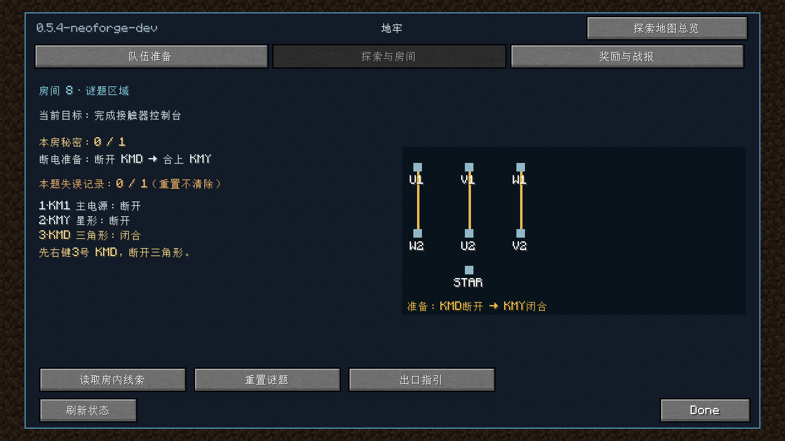
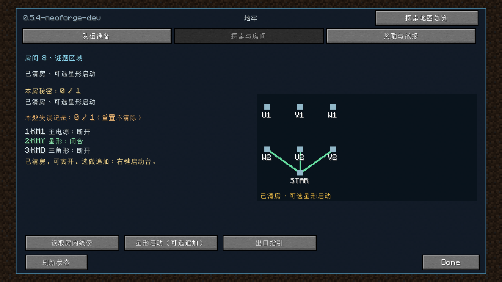
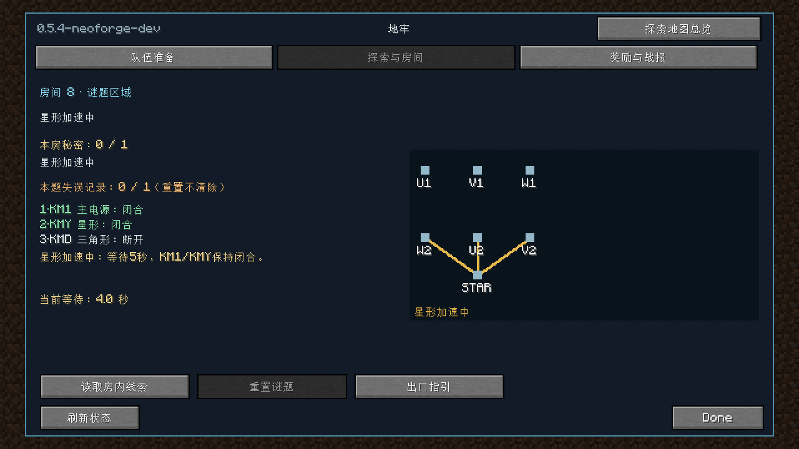
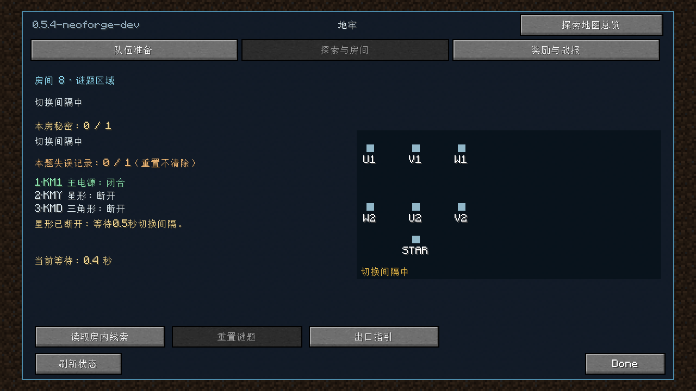
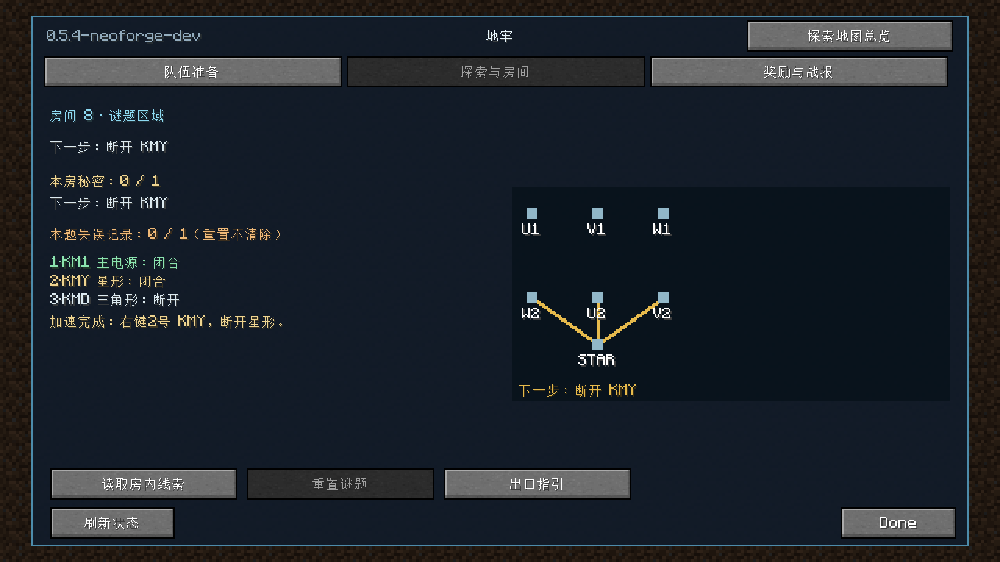
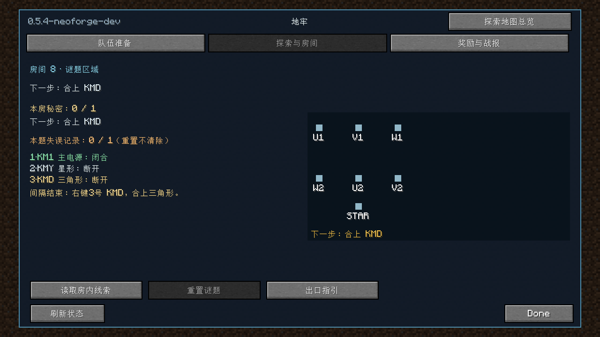
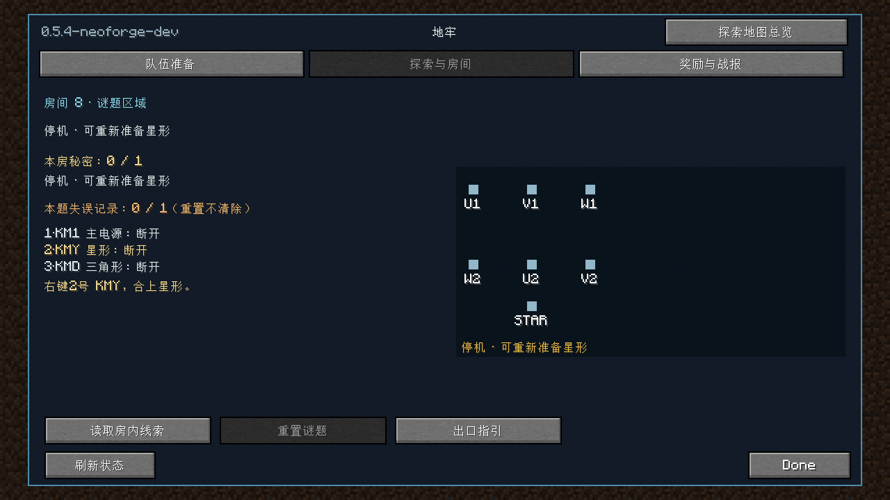
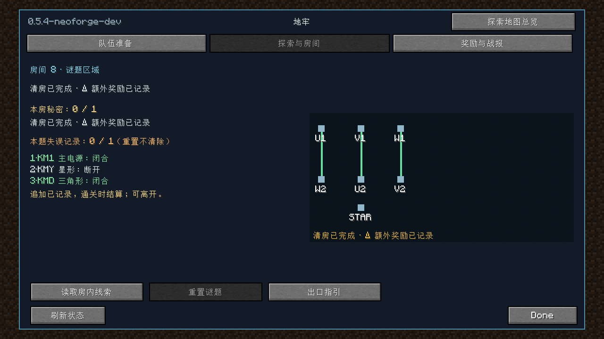

# 继电机房动态指引

2026-11-02，当前工作区 Minecraft 1.20.1 / NeoForge 47.1.106 / JDK17。玩家说明见[接触器机房](../CONTACTOR_ROOM.md)。

## 改动范围

- 服务端统一计算当前步骤：断开 KMD、合上 KMY、可选启动、加速等待、断开 KMY、间隔等待、合上 KMD、追加完成。停机后按实际开合状态重新准备；100/10 tick边界继续由既有规则决定。
- 聊天在操作或互锁拒绝后发送当前步骤及必要倒计时，检修说明保留完整教程和本局奖励数额。启动台未就绪时解释当前步骤，保留未清房时潜行复位行为。
- HUD 增加步骤与倒计时区域；主状态区分停机、加速、切换间隔和可切换阶段。房间菜单缩短控制点名称以保留开合状态，突出下一处控制点，并展示同一服务端步骤。
- 状态投影增加可选的 `console_step` 和 `console_next`，包编码及协议号不变；完整指引需要相应两端代码。没有修改房间NBT、布局、奖励、存档字段或生产部署。

## 验证与边界

定向 JUnit 共49项全部通过，无跳过：谜题26项（含新增的步骤、互锁等待边界与停机恢复断言），客户端23项。不是默认全套测试或完整build通过的声明。

开发客户端实际启动并正常退出。投影预览使用真实 `PuzzleProgress` 操作构造各阶段，通过实际“当前房间详情”按钮进入房间菜单。已查看准备、清房可离开、加速、间隔、两次切换就绪、停机和完成截图；文字、状态、高亮和倒计时没有互相覆盖。这是菜单投影预览，没有真人操作、HUD实景或聊天实景截图。

中文资源已解析，新增步骤和阶段键齐全，无重复键；`git diff --check` 通过。未执行默认完整构建、真人双客户端、断线重连、重启恢复、完整整合包或生产服验收。

命令（本地JDK17；不执行clean）：

```powershell
.\gradlew.bat --offline --console=plain -I tools/ci/runtime.init.gradle test --tests 'cn.saodg.domain.puzzle.*' --tests 'cn.saodg.client.*' runClient -PpuzzlePreview runGameTestServer -PgameTestNamespaces=saodg_circuit -PgameTestRunDirectory=run/guidance-20261102 -x downloadAssets
# 主状态修正后，重跑定向JUnit和同一命名空间的GameTest：
.\gradlew.bat --offline --console=plain -I tools/ci/runtime.init.gradle test --tests 'cn.saodg.domain.puzzle.*' --tests 'cn.saodg.client.*' runGameTestServer -PgameTestNamespaces=saodg_circuit -PgameTestRunDirectory=run/guidance-20261102 -x downloadAssets
```

日志：`logs/contactor-guidance-final-20261102.log`（菜单预览和首轮运行）、`logs/contactor-guidance-runtime-20261102.log`（最终主状态修正后）。

## 菜单截图

| 准备：断开 KMD | 已清房：可选启动 |
| --- | --- |
|  |  |

| 加速等待 | 间隔等待 |
| --- | --- |
|  |  |

| 断开星形 | 合上三角形 |
| --- | --- |
|  |  |

| 停机后恢复 | 追加完成 |
| --- | --- |
|  |  |
