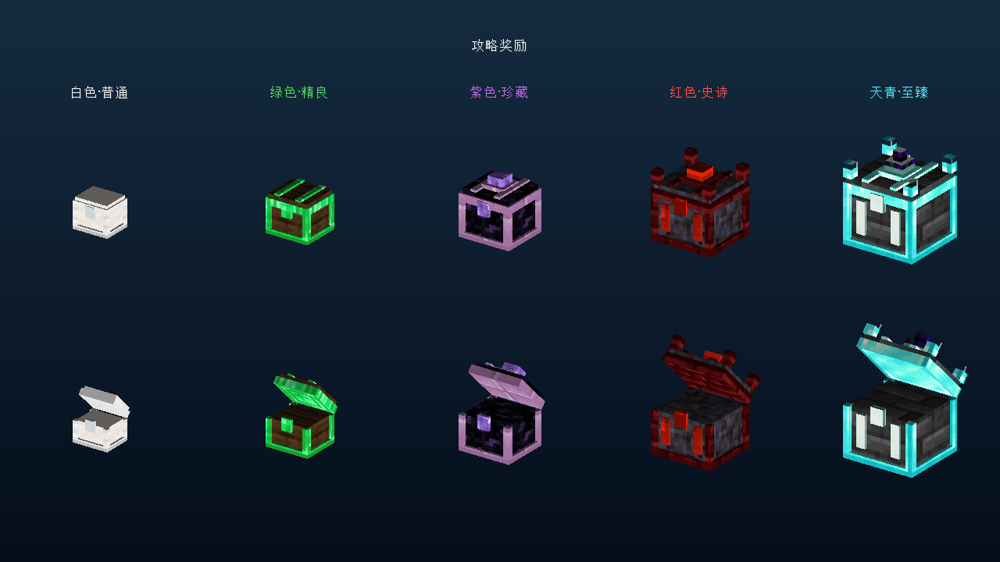
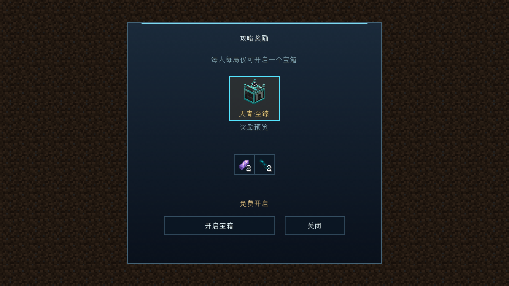
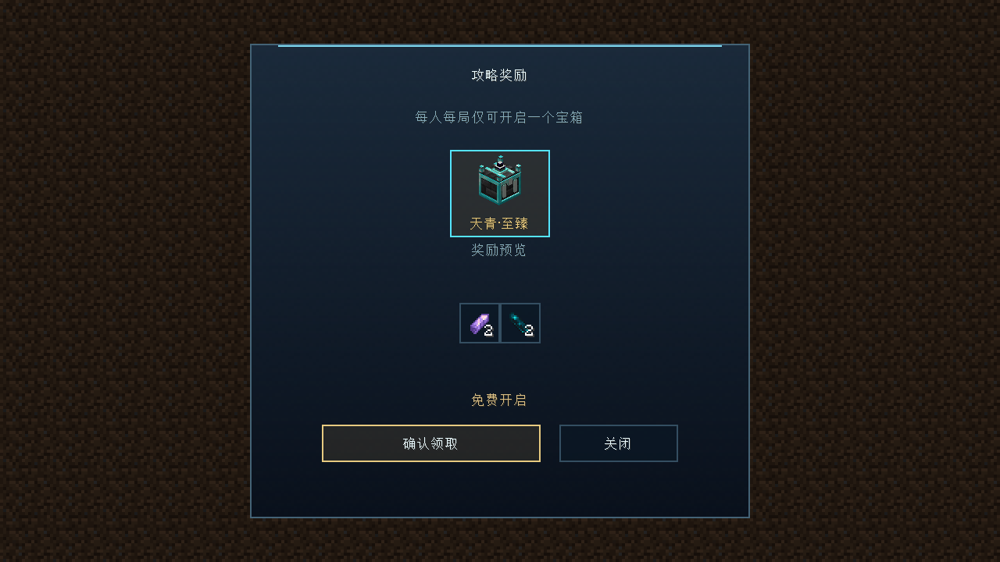
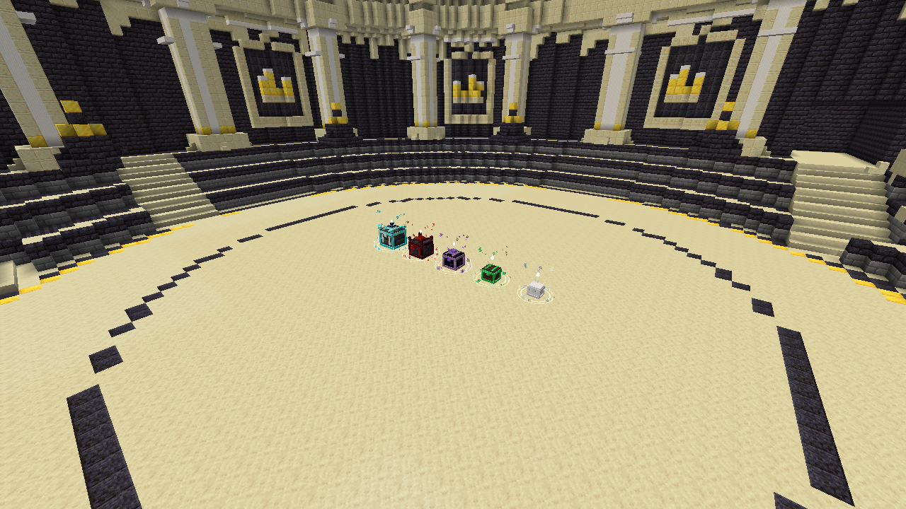

# 五档奖励箱与按实体入口限定预览 — 2026-11-02

本次基于工作区 `0.5.4-neoforge-dev`，使用 JDK 17、NeoForge 47.1.106、ForgeGradle 6.0.54。未修改其他任务已有的玩法、建筑及配置改动。

## 行为

| 档位 | 固定方案 ID | 默认最低分 | 模型倍率 |
| --- | --- | ---: | ---: |
| 白色·普通 | `common` | 0 | 1.20 |
| 绿色·精良 | `fine` | 180 | 1.35 |
| 紫色·珍藏 | `treasured` | 230 | 1.50 |
| 红色·史诗 | `crimson` | 270 | 1.65 |
| 天青·至臻 | `azure` | 290 | 1.80 |

两个内置奖励表均采用五档。基础奖励不变；红、天青档在原紫档物品数量上递增，材料模式封印核心概率分别为 40% 和 60%，仍遵守难度和本人绑定规则、珂尔变动为零。这些仍是开发奖励参数，未作生产经济验收。

首领房按实际得分，同时显示所有达分档位。按同日追加要求，布局已改为：白、绿、紫、红固定在边长 8 格正方形的西北、东北、东南、西南四角，各自斜向朝着正中心；第五档天青位于中心，面向入场方向。少于四档时只占用已解锁的对应角位，不随数量改变已有箱子的位置。整组优先使用房间中心，受阻时整体寻找附近安全位置。每个箱子独立登记 UUID、档位、精确坐标及朝向；摆放前检查整组地板、空气、房间边界、实体与开盖空间，插入失败回滚。保留原地形，不替换方块、方块实体或库存。各档交互框按箱体尺寸同步。追加布局的验证与截图见[四角布局记录](REWARD_CHEST_CORNERS_2026-11-02.md)。

右键实体箱捕获本局 UUID 和档位，仅显示该档箱子及物品；基础奖励和其他局不在该入口显示。定时同步或窗口缩放不会丢失入口限制。`/saodg`、NPC 和个人奖励页保留全部可领奖方案，不继承实体箱的显示限制。

每人每局仍只有一个 `CHEST` 奖励操作，所有档位共用同一个持久化选择与回执。开启某档后不能改选其他档；重复请求、保存确认与恢复沿用原事务。其他队员各自选择。新增五档仅作用于新生成方案，已经落盘的旧局方案、数量、哈希与领取状态不变，不补发新档。原三个档位 ID 和枚举顺序保留，新档追加；网络协议为 **28**，两端需要更新。

模型由 `python tools/structures/generate_reward_chest_models.py` 生成，使用原版纹理，无新增位图依赖。

## 初版直线布局验证

- 定向 `build test --tests 'cn.saodg.domain.reward.*' --tests 'cn.saodg.client.*'` 成功：36 项 JUnit 全通过，编译主代码、GameTest 和 packTest，并生成主 JAR。
- `saodg_completion_rewards` 命名空间：5 项 GameTest 全通过。覆盖整组五箱对称居中、各档交互框不重叠、登记身份和重复摆放复用；实际交互事件、其他队伍、伪造 UUID 对象、错误阶段、旁观、距离和隔墙校验；原有结算恢复与奖励落盘故障测试。
- 五档实物领奖共用操作：300 分同时提供五档，领取绿色后其余四档均被拒绝；原有真实玩家文件保存、重复领取、固定方案及回执冲突检查通过。
- UI 客户端预览成功：数据中同时放入其他档位、基础奖励、历史局；断言天青实体入口只生成一个天青档按钮。移除一次性入口字段并全量同步、缩放重建后仍保持原档位限制。
- 客户端五档开合模型与单档 UI 截图已人工查看；场景截图见下方。
- `python tools/verification/content_audit.py --check` 通过：80 间启用房、5 间保护的非活动功能定义、340／340 个生产模板。
- 资源检查通过：40 个方块状态引用完整的 10 个模型，五档中文名称齐全，语言文件没有重复键；`git diff --check` 通过。

默认输出目录曾与另一个 Gradle 构建发生文件占用；随后只隔离输出仍受共享 Gradle 任务历史清理影响，终止该次无过滤全量构建。最终使用独立输出和项目缓存完成以上定向验证，**没有把默认完整测试套件报告为通过**。未执行真人双客户端、网络断线重连、独立进程重启及生产整合包验收；落盘恢复证据限于已有故障注入 GameTest。

临时初始化脚本 `build/reward-five-tiers.init.gradle`（忽略输出）内容：

```groovy
allprojects {
    layout.buildDirectory = project.file('build/reward-five-tiers-check')
    afterEvaluate {
        minecraft.runs.client.workingDirectory project.file('run/client-reward-five-tiers-20261102')
    }
}
```

实际验证命令（均不执行 `clean`；本机缓存已具备）：

```powershell
$env:JAVA_HOME = 'D:\Java\jdk-17'
.\gradlew.bat --offline --console=plain --max-workers=1 --project-cache-dir build/reward-five-tiers-cache -I build/reward-five-tiers.init.gradle -I tools/ci/runtime.init.gradle build test --tests 'cn.saodg.domain.reward.*' --tests 'cn.saodg.client.*' runGameTestServer -PgameTestNamespaces=saodg_completion_rewards -PgameTestRunDirectory=run/reward-five-tiers-20261102
.\gradlew.bat --offline --console=plain --max-workers=1 --project-cache-dir build/reward-five-tiers-cache -I build/reward-five-tiers.init.gradle -I tools/ci/runtime.init.gradle runClient -PrewardChestPreview -x downloadAssets
.\gradlew.bat --offline --console=plain --max-workers=1 --project-cache-dir build/reward-five-tiers-cache -I build/reward-five-tiers.init.gradle -I tools/ci/runtime.init.gradle runClient -PrewardChestScenePreview -PrewardChestSceneWorld=reward-five-tiers-final -PrewardChestSceneOutput=build/previews/reward-five-tiers -x downloadAssets
```

场景预览使用已结束的本次 NeoForge GameTest 世界副本，不写入原预览世界或生产世界。每次预览应使用新副本：已放置建筑会被原有空槽预检拒绝。预览期间保留建筑放置区块票据，防止旁观相机转移前卸载无存档的临时箱子。日志在 `build/reward-five-tiers-final.log`、`build/reward-five-tiers-ui-verified.log`、`build/reward-five-tiers-scene-final.log`；主 JAR 在 `build/reward-five-tiers-check/libs/`。

## 初版模型与界面截图







以下场景截图为初版直线布局，四角布局以[追加验证记录](REWARD_CHEST_CORNERS_2026-11-02.md)为准。


