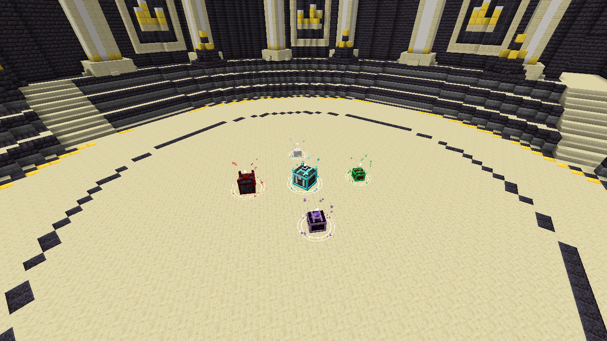
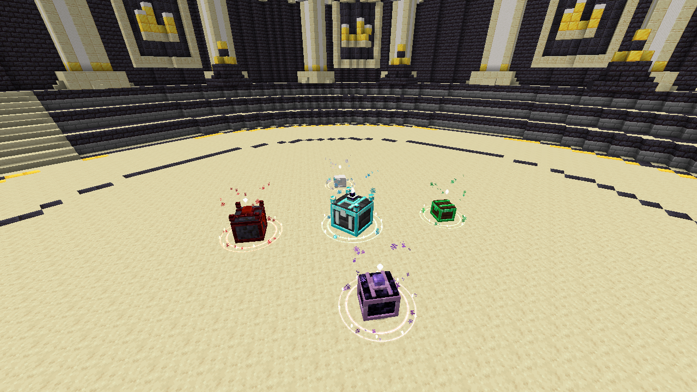

# 奖励箱四角朝内与第五箱居中 — 2026-11-02

本轮接续五档奖励箱修改，仍使用 `0.5.4-neoforge-dev`、NeoForge 47.1.106、JDK 17、协议 28。

## 最终布局

以 Boss 场地正中心为基准，使用边长 8 格的正方形，四角箱子各斜向正中心：

| 档位 | 位置 | 相对中心坐标 X / Z | 朝向 |
| --- | --- | --- | --- |
| 白色 | 西北角 | -4 / -4 | 东南 |
| 绿色 | 东北角 | +4 / -4 | 西南 |
| 紫色 | 东南角 | +4 / +4 | 西北 |
| 红色 | 西南角 | -4 / +4 | 东北 |
| 天青 | 正中心 | 0 / 0 | 入场方向 |

只显示已达分档位，前四档始终使用固定角位，新增一档不重新移动已有档位。第五档解锁后占据中心。受阻时仍整组寻找附近安全位置，并一起保留四角、中心及朝向关系；不挖除原地形。预检仍包含地板、方块实体、房间边界、其他实体及开盖空间，保持全组插入失败回滚和重复摆放复用。

纯几何规则在 `domain/reward/RewardChestLayout.java`，场景负责安全选址和生成。四角以 -45／45／135／-135 度设置实体朝向，交互框横向扩展至覆盖斜放后的箱体边角，中心箱保留原尺寸。使用现有实体同步，不新增协议或存档字段。每局只选一箱、按实体档位限定 UI、命令与 NPC 菜单入口、奖励表及另一路传送门实现保持原有行为。

## 验证

- 定向 JUnit：38 项通过，0 失败、0 错误、0 跳过。新增检查一至五档的固定位置、仅第五档居中、四角前方向量准确指向中心，以及开盖间隔。
- 定向 `build test --tests ... runGameTestServer` 成功，6 项 GameTest 全部通过：五箱交互与一至四箱固定角位、开盖、归属及领奖回执故障恢复；三种生产 Boss 场地各四种旋转的四角朝向、中心天青箱、战后门位置与成员返回、外来内容预检和箱子清理。运行日志 `build/reward-corners-final.log`，完整任务耗时 2 分 16 秒。
- 斜放交互框修正后重跑相同定向构建与运行测试：38 项 JUnit、6 项 GameTest 全通过，包含箱体边角的点击范围与箱子之间不重叠检查。日志 `build/reward-corners-final-bounds.log`，完整任务耗时 1 分 47 秒。最终归档采用这轮产物。
- 静态资源几何核对：五档开合模型在各自朝内角度下，全部顶点仍位于实际安全预检保留的空间内。
- 内容审计通过：80 间启用房、5 间保护的非活动定义、340／340 个生产模板；改动文件的 `git diff --check` 通过。
- 已核对新 JAR 中的 `EncounterService`、`EnemyCombatService`、`ExitPortalScene` 与另一路传送门归档包逐字节一致，保留该 agent 的完整生产代码。新增布局类已包含，主包不包含 GameTest 类。
- 新隔离客户端预览成功，保存并人工查看四角朝内、天青居中的实际场景。日志 `build/reward-corners-scene-verified.log`，任务耗时 1 分 56 秒。之后仅扩大斜放箱子的交互框，模型、位置、朝向与截图相同。

运行命令（不执行 `clean`，沿用独立输出及项目缓存）：

```powershell
$env:JAVA_HOME = 'D:\Java\jdk-17'
.\gradlew.bat --offline --console=plain --max-workers=1 --project-cache-dir build/reward-five-tiers-cache -I build/reward-five-tiers.init.gradle -I tools/ci/runtime.init.gradle build test --tests 'cn.saodg.domain.reward.*' --tests 'cn.saodg.client.*' runGameTestServer '-PgameTestNamespaces=saodg_completion_rewards,saodg_exit' -PgameTestRunDirectory=run/reward-corners-final-20261102
.\gradlew.bat --offline --console=plain --max-workers=1 --project-cache-dir build/reward-five-tiers-cache -I build/reward-five-tiers.init.gradle -I tools/ci/runtime.init.gradle runClient -PrewardChestScenePreview -PrewardChestSceneWorld=reward-corners-final-20261102 -PrewardChestSceneOutput=build/previews/reward-corners-20261102 -x downloadAssets
```

场景预览使用先前已结束的隔离 GameTest 世界的新副本，保留放置区块票据，自动通过副本的实验性维度提示；不写入原世界或生产世界。

临时脚本 `build/reward-five-tiers.init.gradle`（忽略输出）本轮内容：

```groovy
allprojects {
    layout.buildDirectory = file('build/reward-five-tiers-check')
    afterEvaluate {
        minecraft.runs.client.workingDirectory project.file('run/client-reward-corners-20261102')
    }
}
```

首轮验证进程被中断，未计为成功；随后的截图启动还遇到旧隔离客户端 `saodg-client.toml` 截断导致解析失败。保留日志，使用新的隔离客户端目录重新生成配置，没有修改生产配置或放宽检查。以上 GameTest 结果来自新世界的完整成功运行。

本轮没有执行无过滤完整 JUnit、真人双客户端、网络断线重连或独立进程重启验收。原奖励回执故障注入覆盖由 GameTest 单独证明。

## 构建包

固定归档：`build/verified/reward-corners-20261102/saodg-0.5.4-neoforge-dev.jar`，4,126,088 字节。

SHA-256：`7bd40cb7f529500bdecd974ddc932afef0561bb3efb63aa25b49f6db3185f652`。

ZIP 完整性、布局类存在、传送门类一致及排除测试类检查记录：`build/reward-corners-artifact.json`。

## 场景截图




