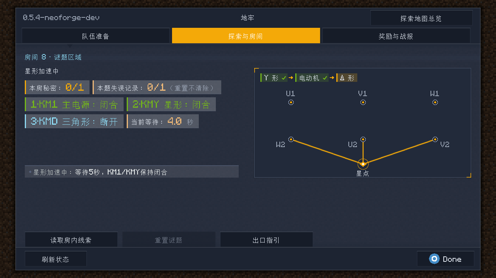
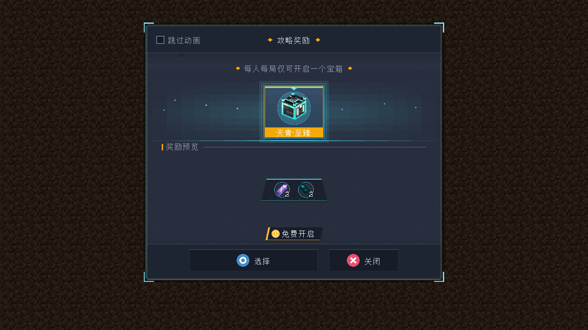
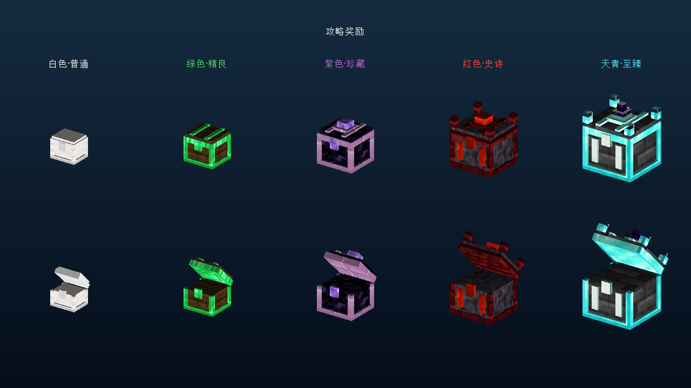

# 指定 UI 提交合入 NeoForge 工作区 — 2026-11-02

源为 `6e0e0aff527ec02806de52277993c30241e7ebed`（完成按钮蓝色确认图标、关闭/取消红叉）。这是截至该提交的整条UI历史，未以其后合并提交 `6958f54` 为合并终点。目标为 `codex/contactor-console-neoforge`，基点 `61099f9`，保留并整合本机已有的0.5.4功能修改。合并先在隔离工作树验证，再写回主工作区；正式历史由对应合并提交记录。

## 整合范围

- 保留 Minecraft 1.20.1 / NeoForge 47.1.106 / ForgeGradle 6.0.54 / Java17、协议28及当前服务端规则；不回退到UI历史分支的Forge版本。
- 引入SAO风格的菜单、HUD、通知卡、设置、奖励卡和开箱动画。保留当前三组菜单导航与设置入口、接触器互锁及倒计时，不恢复旧的接线短路/爆炸交互。
- 接触器板新增专用绘制入口，使用服务端 `contactorBridges` 拓扑；旧接线绘制API仍供历史夹具使用。当前KM1/KMY/KMD状态、下一步提示与等待时间融入新的卡片，HUD空闲通知位继续显示服务器投影的步骤。
- 保留白、绿、紫、红、天青五档实体模型、排序、配色与同局单箱领取约束。原实体箱捕获的run/tier范围在全量同步和调整窗口后保持；物理箱页面不提供跨档再开入口。
- 保留当前房间、首领、传送门、难度、经济和持久化修改；作者素材库及独立结构工作台不因UI整合迁回细节控制台。

## 本轮验证

- 定向 `build test --tests ...` 通过：138项JUnit，0失败、0错误、0跳过；同时编译全部GameTest和packTest夹具并产出开发JAR。这是筛选后的构建，不是无过滤全套通过。
- 定向独立GameTest世界通过10项：`saodg_completion_rewards,saodg_exit,saodg_circuit`，覆盖奖励事务、五档箱子/四角与中心布局、首领出口和接触器。未执行真人双客户端、实际整合包或生产存档验收。
- 两次独立客户端截图任务成功并实际看图：11种谜题状态、实体天青箱仅显示自身档位、开箱暂存界面，以及五档开合模型。首次看图发现把翻译组件转成调试字符串导致越界，已改为本地化纯文本并重跑构建、138项单测及全部谜题截图。最终代表图见下方。
- 生产内容审计通过：80个活动房间、5个保留的未入池功能定义、340/340份模板。
- 首次探索性合并使用较新的UI合并点，旧文案测试失败后已放弃该终点。切换指定提交后，旧测试改为核对当前接触器步骤与互锁提示，新增五档显示契约和合法/非法接触器绘图契约。没有删除服务端互锁、领取或持久化断言。
- 一次本地JDK17 G1并发GC线程出现原生访问异常；该次不计成功。随后仅通过命令行限制处理器并使用SerialGC完成上述成功运行，未改仓库JVM默认配置或测试规则。

本机证据在 `build/ui_merge_20261102/`：`target-6e0e0af-ui-final.log`、`target-6e0e0af-runtime.log`、`target-6e0e0af-reward-preview.log`。原未提交文件逐字节备份及SHA256清单为 `before/`、`before.json`；另保留Git stash安全副本。临时整合工作树不是发布分支，不推送其备份提交。

成功命令（均未执行clean）：

```powershell
$env:JAVA_HOME='D:\Java\jdk-17'
$env:JAVA_TOOL_OPTIONS='-XX:+UseSerialGC -XX:ActiveProcessorCount=2'
.\gradlew.bat -I tools/ci/runtime.init.gradle build test --tests 'cn.saodg.client.*' --tests 'cn.saodg.domain.reward.*' --tests 'cn.saodg.domain.puzzle.ContactorTest' --tests 'cn.saodg.domain.puzzle.DeltaStarWiringTest' runClient -PpuzzlePreview -x downloadAssets --offline --console=plain --max-workers=1 '-Dorg.gradle.jvmargs=-Xmx1536m -XX:+UseSerialGC -XX:ActiveProcessorCount=2 -Dfile.encoding=UTF-8'
.\gradlew.bat -I tools/ci/runtime.init.gradle runGameTestServer -x downloadAssets --offline --console=plain --max-workers=1 '-Dorg.gradle.jvmargs=-Xmx1536m -XX:+UseSerialGC -XX:ActiveProcessorCount=2 -Dfile.encoding=UTF-8' '-PgameTestNamespaces=saodg_completion_rewards,saodg_exit,saodg_circuit' '-PgameTestRunDirectory=run/ui-merge-6e0e0af-20261102'
.\gradlew.bat -I tools/ci/runtime.init.gradle runClient -PrewardChestPreview -x downloadAssets --offline --console=plain --max-workers=1 '-Dorg.gradle.jvmargs=-Xmx1536m -XX:+UseSerialGC -XX:ActiveProcessorCount=2 -Dfile.encoding=UTF-8'
```






